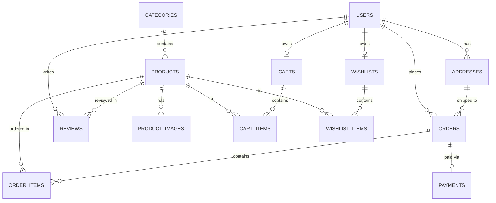
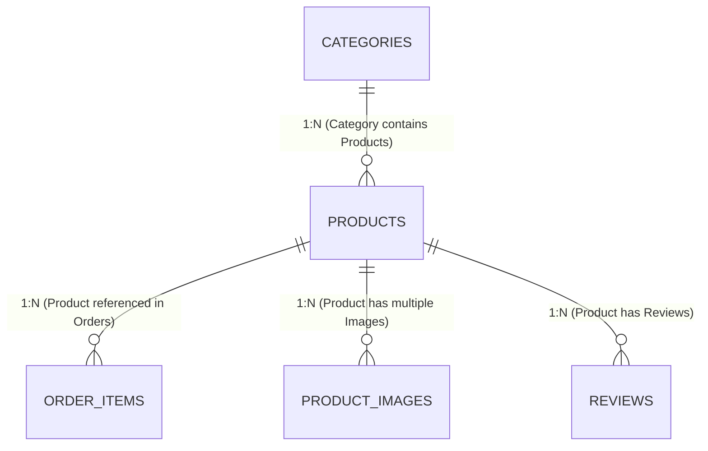
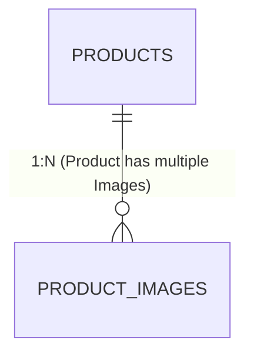
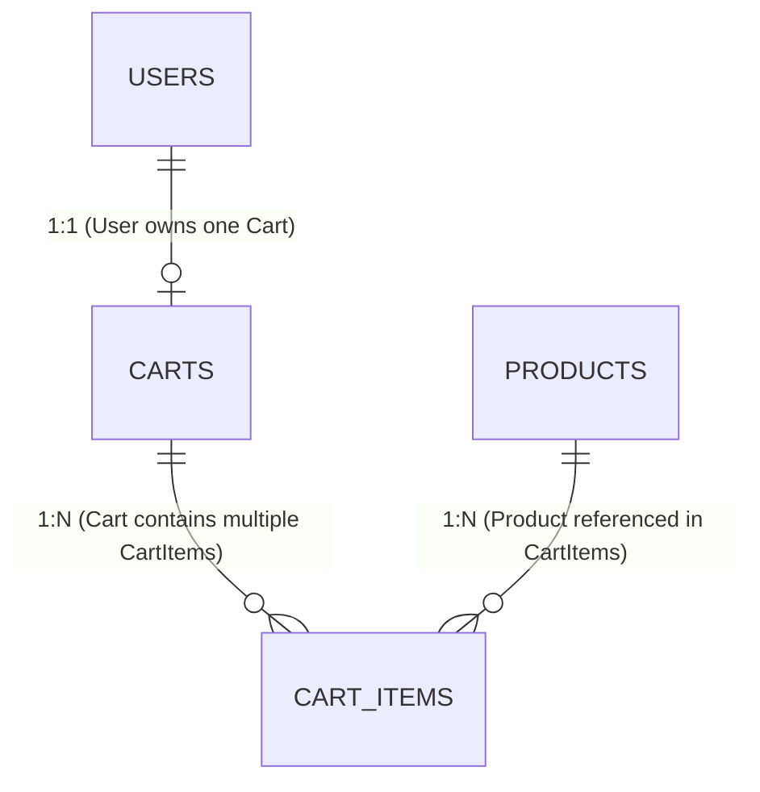
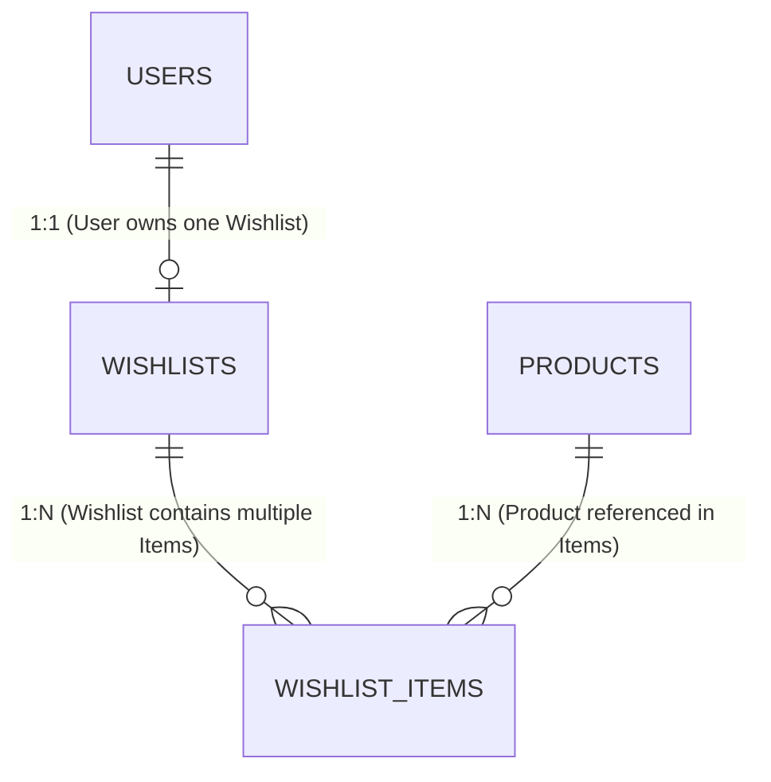
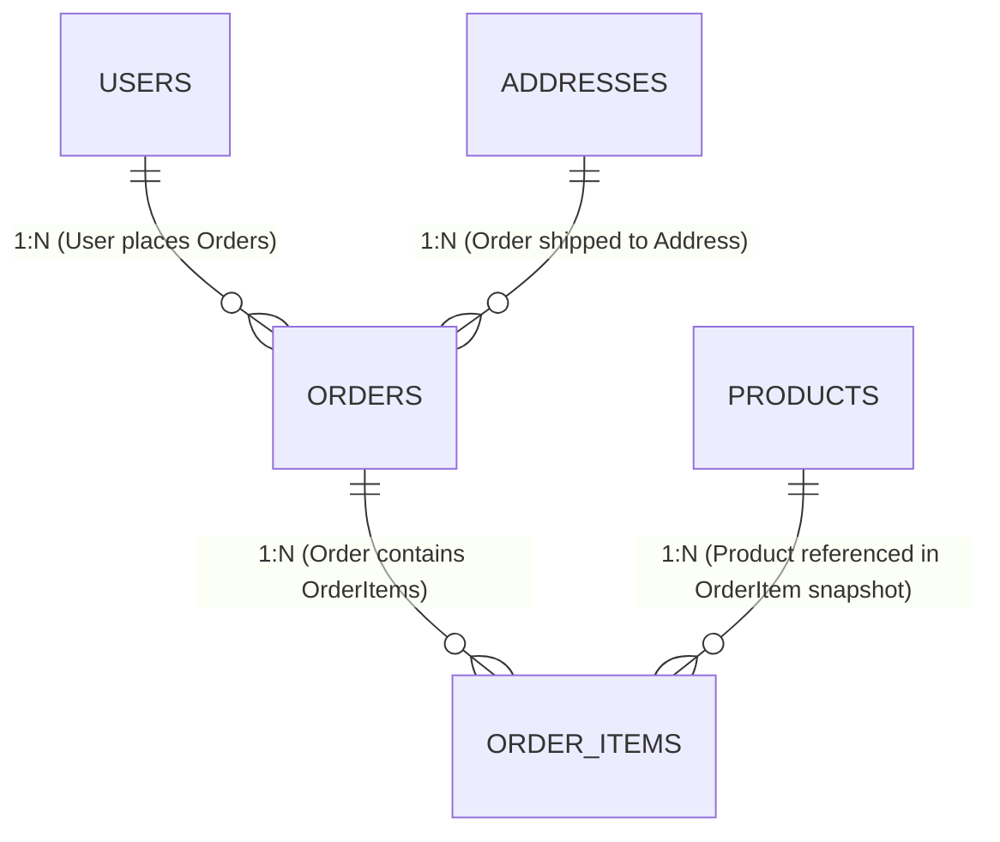
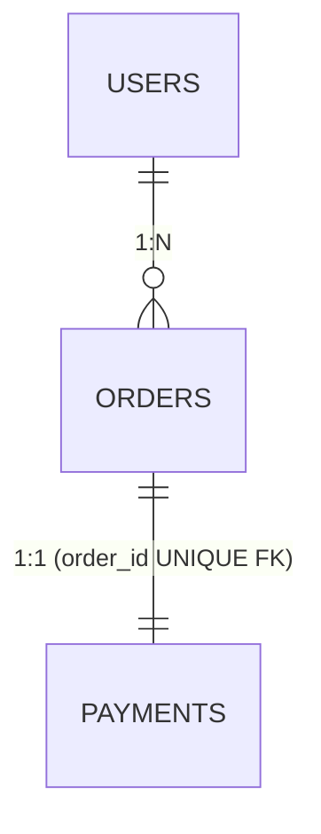
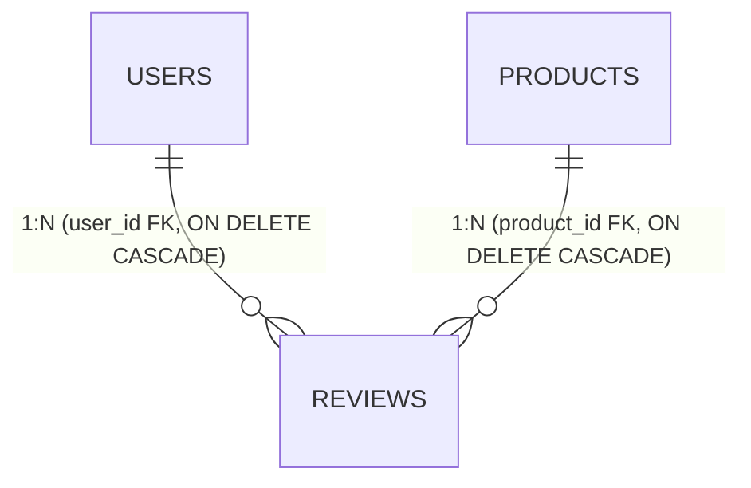
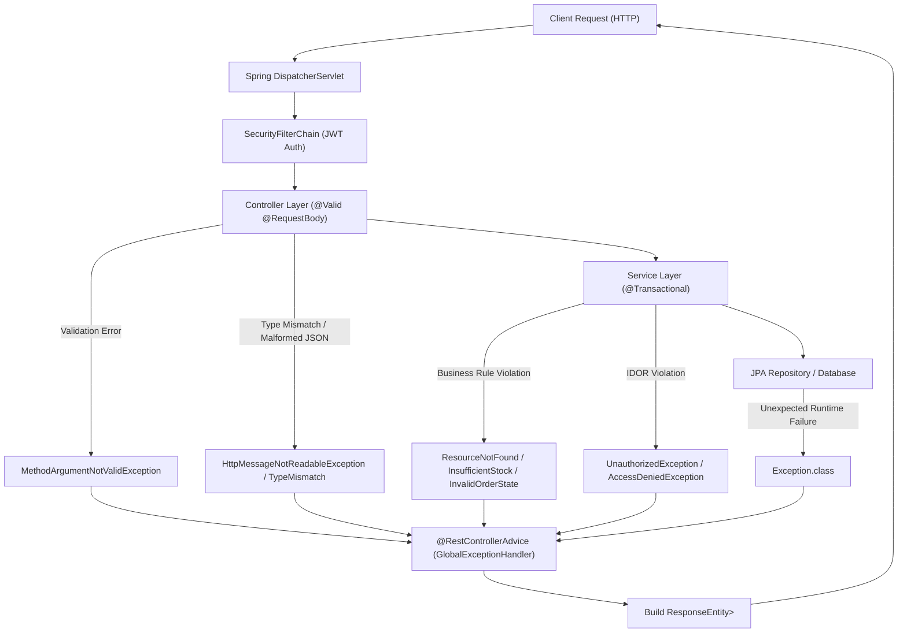
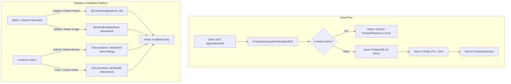

# JPBazaar Development Walkthrough

---

## Phase 1 — Database Architecture

### 1. ER Diagram & Entity Relationships



### 2. Table Schema Definitions (`sql/schema.sql`)
The PostgreSQL schema is established in [`sql/schema.sql`](file:///c:/Users/admin/Desktop/E-COMMERCE/sql/schema.sql) with 13 normalized tables and 15 secondary indexes.

---

## Phase 2 — Spring Boot Foundation

### 1. Maven Configuration (`pom.xml`)
Established Spring Boot 3.3.4 project targeting Java 21 LTS with dependencies:
- `spring-boot-starter-web`
- `spring-boot-starter-data-jpa`
- `spring-boot-starter-security`
- `spring-boot-starter-validation`
- `spring-boot-starter-data-redis`
- `postgresql` (runtime)
- `jjwt-api`, `jjwt-impl`, `jjwt-jackson` (0.12.6)
- `springdoc-openapi-starter-webmvc-ui` (2.6.0)
- `spring-boot-starter-test` & `spring-security-test`

### 2. Package Structure (`com.jpbazaar`)
```
com.jpbazaar
├── config       # OpenApiConfig, SecurityConfig, RedisConfig, JPAConfig
├── controller   # HealthCheckController, AuthController, etc.
├── service      # Business logic & transaction boundaries
├── repository   # Spring Data JPA repositories
├── entity       # JPA domain model
├── dto          # ApiResponse<T>, Request/Response records
├── mapper       # Entity <-> DTO converters
├── security     # JWT filters & SecurityContext utilities
├── exception    # Global exception handler
└── util         # AppConstants
```

### 3. Profile-Based Configuration & Secret Management
- `application.yml`: Base configuration externalized strictly to environment variable placeholders (`DB_URL`, `DB_USERNAME`, `DB_PASSWORD`, `REDIS_HOST`, `REDIS_PORT`, `JWT_SECRET`) without hardcoded secrets.
- `.env.example`: Safe local development environment template file.
- `.gitignore`: Excludes all `.env` files, build targets, and IDE settings from git commits.
- `application-dev.yml`: SQL formatting & debug logging enabled for local development.
- `application-test.yml`: H2 in-memory mode enabled for fast unit testing.

### 4. Build & Test Verification
Run via Maven:
```bash
mvn clean test
```
**Output**: `BUILD SUCCESS`, 1/1 context test passed in 9.6 seconds.

---

## Phase 3 — Entity Layer

### 1. Implemented JPA Domain Entities
Implemented 13 JPA entities in `com.jpbazaar.entity`:
1. **`User`**: `@Entity`, `@Table(name = "users")`, 1:N `Address`, 1:1 `Cart`, 1:1 `Wishlist`, 1:N `Order`, 1:N `Review`.
2. **`Address`**: `@Entity`, N:1 `User`.
3. **`Category`**: `@Entity`, 1:N `Product`.
4. **`Product`**: `@Entity`, `@Version` (`Long version` for optimistic locking in Phase 13), N:1 `Category`, 1:N `ProductImage`, 1:N `Review`.
5. **`ProductImage`**: `@Entity`, N:1 `Product`.
6. **`Cart`**: `@Entity`, 1:1 `User`, 1:N `CartItem`.
7. **`CartItem`**: `@Entity`, N:1 `Cart`, N:1 `Product`. Unique constraint on `(cart_id, product_id)`.
8. **`Wishlist`**: `@Entity`, 1:1 `User`, 1:N `WishlistItem`.
9. **`WishlistItem`**: `@Entity`, N:1 `Wishlist`, N:1 `Product`. Unique constraint on `(wishlist_id, product_id)`.
10. **`Order`**: `@Entity`, N:1 `User`, N:1 `Address`, 1:N `OrderItem`, 1:1 `Payment`.
11. **`OrderItem`**: `@Entity`, N:1 `Order`, N:1 `Product`. Historical snapshot of `productName` and `price`.
12. **`Payment`**: `@Entity`, 1:1 `Order`. Unique `transactionId`.
13. **`Review`**: `@Entity`, N:1 `User`, N:1 `Product`. Unique constraint on `(user_id, product_id)`.

### 2. Supporting Domain ENUMs
- **`Role`**: `CUSTOMER`, `ADMIN`
- **`OrderStatus`**: `PLACED`, `CONFIRMED`, `PROCESSING`, `SHIPPED`, `OUT_FOR_DELIVERY`, `DELIVERED`, `CANCELLED`
- **`PaymentMethod`**: `CARD`, `UPI`, `NET_BANKING`, `COD`
- **`PaymentStatus`**: `PENDING`, `SUCCESS`, `FAILED`, `REFUNDED`

---

## Phase 4 — Repository Layer

### 1. Implemented Spring Data JPA Repositories (`com.jpbazaar.repository`)
1. **`UserRepository`**: `findByEmail`, `existsByEmail`.
2. **`AddressRepository`**: `findByUserId`, `findByUserIdAndIsDefaultTrue`.
3. **`CategoryRepository`**: `findByName`, `existsByName`.
4. **`ProductRepository`**: `findBySku`, `existsBySku`, `findByCategoryIdAndActiveTrue`, and dynamic JPQL `searchAndFilterProducts(...)` supporting multi-parameter filtering (Category, Brand, Price Range, Active Status, Keyword) with `Pageable`.
5. **`ProductImageRepository`**: `findByProductId`.
6. **`CartRepository`**: `findByUserId`, and `findByUserIdWithItems` (`LEFT JOIN FETCH`) to solve N+1 select queries.
7. **`CartItemRepository`**: `findByCartIdAndProductId`, `deleteByCartId`.
8. **`WishlistRepository`**: `findByUserId`, `findByUserIdWithItems` (`LEFT JOIN FETCH`).
9. **`WishlistItemRepository`**: `findByWishlistIdAndProductId`, `existsByWishlistIdAndProductId`, `deleteByWishlistId`.
10. **`OrderRepository`**: `findByUserId(Pageable)`, `findByIdAndUserId` (IDOR check helper), `findByStatus(Pageable)`, and `findByIdWithItems` (`LEFT JOIN FETCH`).
11. **`OrderItemRepository`**: `findByOrderId`.
12. **`PaymentRepository`**: `findByOrderId`, `findByTransactionId`, `existsByTransactionId`.
13. **`ReviewRepository`**: `findByProductId(Pageable)`, `existsByUserIdAndProductId`, `findAverageRatingByProductId` (JPQL `SELECT COALESCE(AVG(r.rating), 0.0)`).

---

## Phase 5 — Authentication & Authorization

### 1. Security Architecture & Features
- **Stateless JWT Security**: Requests authenticated via `Authorization: Bearer <token>` header.
- **BCrypt Password Hashing**: Passwords stored as BCrypt hashes (strength 12).
- **Auto Cart/Wishlist Provisioning**: Registering a customer automatically creates their individual `Cart` and `Wishlist`.

### 2. Implemented Security Components (`com.jpbazaar.security`)
- **`JwtTokenProvider`**: Generates, signs (HMAC-SHA), parses, and validates JWT tokens with `userId` and `role` claims.
- **`SecurityUser`**: Adapts `User` entity to Spring Security `UserDetails`.
- **`CustomUserDetailsService`**: Loads user details from database by email.
- **`JwtAuthenticationFilter`**: Intercepts requests, validates token, and populates `SecurityContextHolder`.
- **`SecurityConfig`**: Configures stateless session policy, CORS, public endpoints (`/api/auth/**`, GET `/api/products/**`), and ADMIN role endpoints.
- **`AuthController`**:
  - `POST /api/auth/register`
  - `POST /api/auth/login`

---

## Phase 6 — User Module & Address Book

### 1. Implemented Features
- **User Profile Management**:
  - `GET /api/users/me`: Fetch authenticated user profile.
  - `PUT /api/users/me`: Update first name, last name, and phone.
  - `PUT /api/users/change-password`: Change password with current password verification.
- **Address Book Management (CRUD + Default)**:
  - `POST /api/addresses`: Add new shipping/billing address (auto-sets first address as default).
  - `GET /api/addresses`: List authenticated user's addresses.
  - `GET /api/addresses/{id}`: Get address by ID (IDOR protected).
  - `PUT /api/addresses/{id}`: Update address details (IDOR protected).
  - `DELETE /api/addresses/{id}`: Delete address (IDOR protected).
  - `PUT /api/addresses/{id}/set-default`: Set default address for checkout.

### 2. IDOR (Insecure Direct Object Reference) Protection Strategy
To prevent malicious customers from tampering with URL IDs (e.g., trying `GET /api/addresses/10` to view another user's address), every address operation executes an explicit ownership check:

```java
private Address getAddressAndValidateOwnership(String email, Long addressId) {
    Address address = addressRepository.findById(addressId)
            .orElseThrow(() -> new ResourceNotFoundException("Address not found with ID: " + addressId));

    if (!address.getUser().getEmail().equals(email)) {
        throw new UnauthorizedException("Access denied: You do not own address ID " + addressId);
    }
    return address;
}
```
If the authenticated user's email does not match the resource owner's email, the application throws `UnauthorizedException`, returning HTTP 403 Forbidden.

---

## Architecture & Layered Responsibilities Explanation

| Layer | Responsibility | Why Separated? |
|---|---|---|
| **Entity** | Maps Java objects directly to database tables (ORM). | Keeps DB schema details and ORM mapping decoupled from API response formats. |
| **DTO** | Data Transfer Object for API request/response payloads. | Prevents exposure of sensitive fields (e.g. `password`, internal DB IDs), avoids Jackson recursion, and stabilizes API contracts. |
| **Repository** | Data access layer (Spring Data JPA queries, JPQL). | Encapsulates database execution logic away from business services. |
| **Service** | Core business rules, transactions (`@Transactional`), and security guards. | Centralizes domain rules so they can be re-used across controllers, CLI tools, or background tasks. |
| **Controller** | HTTP endpoint handling, request parameter binding, DTO validation. | Translates web protocols (REST/JSON) to Java method calls; keeps web logic out of domain services. |

---

## Interview Preparation — Phase 6 Key Technical Questions

### Q1: What is IDOR (Insecure Direct Object Reference) and how is it mitigated in JPBazaar?
**Answer**: IDOR occurs when an application exposes a reference to an internal implementation object (like an integer ID in a URL `/api/addresses/5`), allowing an attacker to manipulate the parameter to access unauthorized data. We mitigate IDOR by enforcing contextual ownership checks in `AddressServiceImpl` and JPQL queries (`findByIdAndUserId`), ensuring the authenticated principal owns the requested resource before returning data.

### Q2: Why pass `@AuthenticationPrincipal UserDetails userDetails` to controllers instead of accepting `Long userId` as a `@PathVariable` or `@RequestParam`?
**Answer**: Accepting `userId` in parameters allows malicious users to send someone else's ID. Relying on `@AuthenticationPrincipal` retrieves the user's identity directly from the cryptographically verified JWT token inside `SecurityContextHolder`, eliminating parameter tampering attacks.

### Q3: How do you handle setting a new Default Address when another address is already marked as default?
**Answer**: In `AddressServiceImpl`, when `isDefault = true` is passed, the service queries `findByUserIdAndIsDefaultTrue(userId)` within an `@Transactional` block, unsets the previous default address (`isDefault = false`), and marks the target address as default.

---

## Phase 7 — Product and Category Module

### 1. Overview & Architecture
Phase 7 implements full management and discovery of catalog items:
- Hierarchical **Categories** (`Category`) with uniqueness rules and deletion safety constraints.
- Multi-dimensional **Products** (`Product`) with optimistic locking support (`@Version`), SKU uniqueness, rich attribute management, dynamic multi-parameter search/filtering, and historical order protection.
- Standardized, pagination-aware API responses using a decoupled `PageResponse<T>` DTO.

### 2. Key Components & Implementation Details

#### DTOs (`com.jpbazaar.dto`)
- **`CategoryRequest`**: Validates category name (`@NotBlank`, max 100) and optional description.
- **`CategoryResponse`**: Clean read model exposing category ID, name, description, and audit timestamp.
- **`ProductCreateRequest`**: Strict validation for adding products (`name`, `description`, positive `price`, non-negative `stockQuantity`, `sku`, `brand`, `categoryId`).
- **`ProductUpdateRequest`**: Partial/full modification of product attributes with stock validation.
- **`ProductResponse`**: Rich catalog item model including category reference (`categoryName`, `categoryId`), active flag, and stock level.
- **`PageResponse<T>`**: Generic paginated metadata wrapper (`content`, `pageNumber`, `pageSize`, `totalElements`, `totalPages`, `isLast`) ensuring decoupling from internal Spring Data classes.

#### Repository Extensions (`com.jpbazaar.repository`)
- **`CategoryRepository`**:
  - `existsByNameAndIdNot(String name, Long id)`: Enforces unique category names across updates.
- **`ProductRepository`**:
  - `existsByCategoryId(Long categoryId)`: FK constraint safety check preventing deletion of categories that have active products.
  - `existsBySkuAndIdNot(String sku, Long id)`: Enforces unique SKU codes during product updates.
  - `searchAndFilterProducts(...)`: Single dynamic JPQL query with optional filters for `categoryId`, `brand`, `minPrice`, `maxPrice`, `active`, and case-insensitive keyword search matching name or description, seamlessly integrated with `Pageable`.
- **`OrderItemRepository`**:
  - `existsByProductId(Long productId)`: Blocks hard deletion of products that have already been ordered by customers.

#### Services (`com.jpbazaar.service`)
- **`CategoryServiceImpl`**:
  - Prevents duplicate category names (`DuplicateResourceException`).
  - Guards category deletion: Rejects deletion if any products belong to the category (`InvalidRequestException`), preserving database integrity.
- **`ProductServiceImpl`**:
  - Enforces SKU uniqueness across creation and updates.
  - Validates category existence before linking.
  - Guards product deletion: Blocks deletion if the product exists in historical orders (`orderItemRepository.existsByProductId`). For products with purchase history, soft deactivation (`active = false`) is required instead of hard deletion.
  - Dynamic product search & pagination with Spring Data `Pageable` and sort orders.

#### Controllers & Endpoints
- **`CategoryController`** (`/api/categories`):
  - `POST /api/categories`: Admin only (HTTP 201 Created)
  - `GET /api/categories`: Public access (HTTP 200 OK)
  - `GET /api/categories/{id}`: Public access (HTTP 200 OK)
  - `PUT /api/categories/{id}`: Admin only (HTTP 200 OK)
  - `DELETE /api/categories/{id}`: Admin only (HTTP 200 OK)
- **`ProductController`** (`/api/products`):
  - `GET /api/products`: Public catalog search, filter, and pagination (HTTP 200 OK)
    - Query parameters: `categoryId`, `brand`, `minPrice`, `maxPrice`, `active`, `keyword`, `page`, `size`, `sortBy`, `sortDir`
  - `GET /api/products/{id}`: Public product details (HTTP 200 OK)
  - `POST /api/products`: Admin only (HTTP 201 Created)
  - `PUT /api/products/{id}`: Admin only (HTTP 200 OK)
  - `DELETE /api/products/{id}`: Admin only (HTTP 200 OK)

---

### 3. Database Relationships



1. **Category to Product (1:N)**: One category groups multiple products. A product belongs to exactly one category (`@ManyToOne(fetch = FetchType.LAZY)`).
2. **Product to OrderItem (1:N)**: An ordered item references a product. Even if product details change later, the order item captures the historical price and name at purchase time.
3. **Product to ProductImage (1:N)**: Products can feature multiple images with a designated primary thumbnail.

---

### 4. Interview Preparation — Phase 7 Key Technical Questions

#### Q1: Why should an e-commerce platform avoid hard-deleting products that have prior purchase history?
**Answer**: Hard-deleting a product that exists in `order_items` causes a foreign key constraint violation (`DataIntegrityViolationException`) or cascades to delete customer order history, destroying tax, accounting, and dispute records. In JPBazaar, we verify `orderItemRepository.existsByProductId(id)` before deletion. If orders exist, hard deletion is rejected and admins must deactivate the item (`active = false`) instead.

#### Q2: How does JPBazaar implement multi-criteria filtering without creating dozens of repository finder methods?
**Answer**: We use dynamic JPQL with coalesced/null-safe parameters:
```sql
WHERE (:categoryId IS NULL OR p.category.id = :categoryId)
  AND (:brand IS NULL OR LOWER(p.brand) = LOWER(:brand))
  AND (:minPrice IS NULL OR p.price >= :minPrice)
  AND (:maxPrice IS NULL OR p.price <= :maxPrice)
  AND (:active IS NULL OR p.active = :active)
  AND (:keyword IS NULL OR LOWER(p.name) LIKE LOWER(CONCAT('%', :keyword, '%'))
       OR LOWER(p.description) LIKE LOWER(CONCAT('%', :keyword, '%')))
```
Spring Data JPA evaluates these conditions conditionally and pairs with `Pageable` to automatically append `LIMIT`, `OFFSET`, and dynamic `ORDER BY` clauses.

#### Q3: Why return a custom `PageResponse<T>` record instead of Spring's `org.springframework.data.domain.Page<T>`?
**Answer**: Returning `Page<T>` directly exposes framework-specific internal structures (such as `pageable.sort.sorted`, `numberOfElements`, `empty`) which complicates frontend consumption, violates the separation between domain persistence abstractions and API contracts, and causes Jackson serialization bloat. `PageResponse<T>` delivers a clean, consistent contract: `content`, `pageNumber`, `pageSize`, `totalElements`, `totalPages`, and `isLast`.

#### Q4: Why is category deletion protected against non-empty categories?
**Answer**: Deleting a category with associated products would leave products orphaned (or cause FK constraint failure). In `CategoryServiceImpl.deleteCategory()`, we run `productRepository.existsByCategoryId(id)` first. If true, the operation immediately aborts with an informative `InvalidRequestException`.

---

## Phase 8 — Product Images

### 1. Overview & Architecture
Phase 8 implements product image management using an extensible, pluggable **Strategy Pattern** for storage:
- **Zero Database Bloat**: Large binary images are stored outside PostgreSQL (on local disk with future drop-in support for Cloudinary or AWS S3). The database stores lightweight image metadata (URL, primary flag, product link).
- **Extensible Storage Abstraction**: `ImageStorageService` interface decouples the product module from the underlying file repository.
- **Multipart Upload & Static Streaming**: Supports multipart binary file uploads (`image/png`, `image/jpeg`, `image/webp`, `image/gif`) and public image streaming with HTTP caching headers.
- **Primary Image Lifecycle**: Guarantees exactly one primary thumbnail per product, auto-assigns the initial upload as primary, and elevates remaining images if the primary image is removed.

### 2. Key Components & Implementation Details

#### Storage Abstraction (`com.jpbazaar.service.storage`)
- **`ImageStorageService`**: Interface declaring `upload(file, folder)`, `delete(imageUrl)`, `loadAsResource(filename)`, and `getContentType(filename)`.
- **`LocalStorageServiceImpl`**:
  - Configurable storage root via `app.upload.dir` (defaults to `uploads/images`, configured to `target/test-uploads` during tests).
  - Validates MIME types (`ALLOWED_CONTENT_TYPES`).
  - Path traversal defense: validates paths, rejects `..` sequences, and normalizes file paths.
  - Generates collision-proof UUID filenames.
  - Gracefully ignores remote CDN URLs (`http://`, `https://`) during local disk deletions.

#### DTOs (`com.jpbazaar.dto`)
- **`ProductImageRequest`**: Validates image URL (`@NotBlank`, max 512) and `isPrimary` flag.
- **`ProductImageResponse`**: Returns `id`, `productId`, `imageUrl`, and `isPrimary`.

#### Repositories (`com.jpbazaar.repository`)
- **`ProductImageRepository`**:
  - `findByIdAndProductId(Long id, Long productId)`: Ensures images belong to the specified product.
  - `findByProductIdAndIsPrimaryTrue(Long productId)`: Retrieves current primary thumbnail.
  - `findByProductIdOrderByIsPrimaryDescIdAsc(Long productId)`: Returns catalog images with the primary image first.

#### Services (`com.jpbazaar.service`)
- **`ProductImageServiceImpl`**:
  - `addImage`: Adds image by URL, auto-sets primary if it's the first image.
  - `uploadImage`: Uploads multipart file via `ImageStorageService`, binds to product.
  - `getProductImages`: Returns all images for product (public).
  - `setPrimaryImage`: Unsets existing primary and sets specified image as primary.
  - `deleteProductImage`: Deletes physical file from disk (if local), removes entity, and auto-elevates first remaining image to primary.

#### Controllers & Endpoints
- **`ProductImageController`** (`/api/products/{productId}/images`):
  - `POST /api/products/{productId}/images`: Admin only (HTTP 201)
  - `POST /api/products/{productId}/images/upload`: Admin only multipart upload (HTTP 201)
  - `GET /api/products/{productId}/images`: Public access (HTTP 200)
  - `PUT /api/products/{productId}/images/{imageId}/primary`: Admin only (HTTP 200)
  - `DELETE /api/products/{productId}/images/{imageId}`: Admin only (HTTP 200)
- **`ImageController`** (`/api/images/{*filePath}`):
  - `GET /api/images/{*filePath}`: Public image streaming with `Cache-Control: public, max-age=86400` and `inline` Content-Disposition.

---

### 3. Database Relationships



- **Product to ProductImage (1:N)**: A product can feature multiple images. One image is designated as `is_primary = true` to serve as the catalog thumbnail. When a product is deleted, all associated `ProductImage` records are deleted via `CascadeType.ALL, orphanRemoval = true`.

---

### 4. Interview Preparation — Phase 8 Key Technical Questions

#### Q1: Why should an e-commerce platform avoid storing image binary data (BLOBs) directly in PostgreSQL?
**Answer**: Storing multi-megabyte binary data in relational tables leads to table bloat, degrades buffer cache hit ratios, exhausts database I/O bandwidth, drastically inflates backup/restore times, and bypasses edge CDN caching. Storing file metadata (URLs) in the database and the actual binary objects on disk or object stores (S3, Cloudinary) separates concerns and allows CDN edge-caching.

#### Q2: How does JPBazaar support switching from local storage to AWS S3 or Cloudinary without rewriting the Product module?
**Answer**: We use the Strategy Pattern via `ImageStorageService`. The controller and product services depend solely on `ImageStorageService`. To switch to AWS S3 or Cloudinary, developers provide an implementation (e.g. `S3ImageStorageService`) annotated with `@ConditionalOnProperty(name = "app.storage.type", havingValue = "s3")`. No modifications to `ProductService` or `ProductImageController` are needed.

#### Q3: How do you prevent Path Traversal attacks during file uploads and downloads?
**Answer**: In `LocalStorageServiceImpl`, file names are sanitized using `StringUtils.cleanPath()`, inspected for `..` relative path segments, and validated against the root storage directory using `destinationPath.normalize().startsWith(rootLocation)`. Furthermore, uploaded files are assigned randomly generated UUIDs, preventing attackers from overwriting system files.

#### Q4: How is primary image consistency maintained when deleting images?
**Answer**: In `ProductImageServiceImpl.deleteProductImage()`, if the deleted image was marked as `isPrimary = true`, the service queries remaining images for that product. If images remain, the first remaining image is automatically elevated to `isPrimary = true`, preventing products from being left without a thumbnail.

---

## Phase 9 — Cart Module

### 1. Overview & Architecture
Phase 9 delivers a shopping cart module for **JPBazaar**:
- **Automatic Lifecycle Provisioning**: Every registered user has a dedicated cart; if missing upon request, it is provisioned on demand.
- **Duplicate Prevention with Quantity Merging**: Adding a product that already exists in the cart merges quantities rather than creating duplicate line items, maintaining the `(cart_id, product_id)` database uniqueness constraint.
- **Strict Business & Stock Validation**: Rejects inactive products and validates requested quantities against real-time stock levels, throwing `InsufficientStockException` if stock is exceeded.
- **IDOR Protection**: Ensures customers can only view, mutate, or delete line items from their own cart.
- **Real-Time Financial Calculations**: Automatically calculates line-item subtotals, cart item count, and total cart amount.

### 2. Key Components & Implementation Details

#### DTOs (`com.jpbazaar.dto`)
- **`AddToCartRequest`**: Validates `productId` (`@NotNull`) and `quantity` (`@Min(1)`).
- **`UpdateCartItemRequest`**: Validates `quantity` (`@NotNull`, `@Min(1)`).
- **`CartItemResponse`**: Details for each cart item (`id`, `productId`, `productName`, `productSku`, `unitPrice`, `quantity`, `subtotal`, `imageUrl`).
- **`CartResponse`**: Cart aggregate view (`id`, `userId`, `items`, `totalItemCount`, `totalAmount`).

#### Exceptions & Error Handling (`com.jpbazaar.exception`)
- **`InsufficientStockException`**: Dedicated exception thrown when a user requests more units than available in stock. Handled by `GlobalExceptionHandler` returning HTTP 400 Bad Request with an informative error message.

#### Repository Extensions (`com.jpbazaar.repository`)
- **`CartRepository`**:
  - `findByUserEmail(String email)`
  - `findByUserEmailWithItems(String email)`: Executes `LEFT JOIN FETCH c.items i LEFT JOIN FETCH i.product p LEFT JOIN FETCH p.category` to solve the N+1 SELECT query problem in a single database round-trip.
- **`CartItemRepository`**:
  - `findByIdAndCartId(Long id, Long cartId)`: Validates ownership to protect against IDOR attacks.
  - `deleteByCartId(Long cartId)`: Enables clearing the entire cart.

#### Services (`com.jpbazaar.service`)
- **`CartServiceImpl`**:
  - `getCart`: Fetches the authenticated user's cart with eager fetch joins.
  - `addToCart`:
    - Validates product existence and active status.
    - Checks for existing product in cart: if found, validates `existingQuantity + newQuantity <= stock` and updates quantity; otherwise creates new `CartItem`.
  - `updateCartItemQuantity`: Validates that the cart item belongs to the caller's cart (IDOR guard) and that the new quantity is within product stock.
  - `removeCartItem`: Verifies cart ownership and deletes the cart item.
  - `clearCart`: Deletes all cart items for the user's cart.
  - `mapToCartResponse`: Calculates subtotals ($unitPrice \times quantity$), total item count ($\sum quantity$), and total amount ($\sum subtotal$), while associating the product's primary thumbnail image.

#### Controllers & Endpoints
- **`CartController`** (`/api/cart`):
  - `GET /api/cart`: Current authenticated user's cart (HTTP 200 OK)
  - `POST /api/cart/items`: Add product to cart (HTTP 201 Created)
  - `PUT /api/cart/items/{itemId}`: Update item quantity (HTTP 200 OK)
  - `DELETE /api/cart/items/{itemId}`: Remove item from cart (HTTP 200 OK)
  - `DELETE /api/cart`: Clear cart (HTTP 200 OK)

---

### 3. Database Relationships



- **User to Cart (1:1)**: Every user owns exactly one cart (`uk_carts_user` unique constraint on `user_id`).
- **Cart to CartItem (1:N)**: A cart holds multiple items. Unique constraint on `(cart_id, product_id)` ensures a product appears at most once in a given cart. When a cart is cleared or deleted, `orphanRemoval = true` ensures associated items are cleanly cascade-deleted.

---

### 4. Interview Preparation — Phase 9 Key Technical Questions

#### Q1: How does JPBazaar prevent duplicate line items when a user adds the same product to their cart twice?
**Answer**: In `CartServiceImpl.addToCart()`, the service inspects the cart's existing items for matching `productId`. If already present, it verifies that the combined quantity (`currentQuantity + requestedQuantity`) does not exceed stock, and updates the existing `CartItem`'s quantity in place instead of creating a second entity. This respects the database `(cart_id, product_id)` unique constraint and prevents database constraint violation errors.

#### Q2: How does JPBazaar avoid the N+1 query problem when loading a user's shopping cart?
**Answer**: Without eager fetching, loading a cart containing 10 items would execute 1 query for the cart, 1 query for the items, and 10 separate queries for each associated product ($1 + 1 + N$). In `CartRepository`, we define `findByUserEmailWithItems`:
```sql
SELECT c FROM Cart c 
LEFT JOIN FETCH c.items i 
LEFT JOIN FETCH i.product p 
LEFT JOIN FETCH p.category 
WHERE c.user.email = :email
```
This loads the entire cart, its items, and product details in a single SQL query.

#### Q3: How is IDOR mitigated when a user updates or deletes a cart item?
**Answer**: An attacker might guess or enumerate `cartItemId` (e.g. `PUT /api/cart/items/45`) to modify someone else's cart. In `CartServiceImpl`, every mutation executes `cartItemRepository.findByIdAndCartId(cartItemId, cart.getId())`. If the item ID does not belong to the authenticated user's cart ID, the query returns empty and the service throws `UnauthorizedException` (HTTP 403 Forbidden).

---

## Phase 10 — Wishlist Module

### 1. Overview & Architecture
Phase 10 implements the Wishlist module for **JPBazaar**:
- **Personalized Product Bookmarking**: Allows registered users to bookmark products they want to save or buy later.
- **Duplicate Prevention**: Enforces a strict uniqueness invariant per user wishlist. If a product is already on the user's wishlist, attempting to re-add it results in an HTTP 409 Conflict via `DuplicateResourceException`.
- **Eager Fetch Join Optimization**: Eliminates the N+1 query problem by using JPQL `LEFT JOIN FETCH` across wishlist items, product entities, and categories in a single query.
- **IDOR Protection**: Verifies ownership before removing wishlist items (`findByIdAndWishlistId`), ensuring users cannot manipulate other users' wishlists.
- **Dual Removal Options**: Supports removing items by wishlist item ID (`DELETE /api/wishlist/items/{itemId}`) or directly by product ID (`DELETE /api/wishlist/products/{productId}`), facilitating seamless toggle UI integration on product cards.
- **Stock and Image Enrichment**: Projects live stock availability (`inStock`) and primary thumbnail image URLs on each wishlist item response.

### 2. Key Components & Implementation Details

#### DTOs (`com.jpbazaar.dto`)
- **`AddToWishlistRequest`**: Contains `@NotNull Long productId` to identify which product to add.
- **`WishlistItemResponse`**: Structured response for individual wishlisted items:
  - `id`: Unique identifier of the wishlist item.
  - `productId`: ID of the wishlisted product.
  - `productName`: Name of the product.
  - `productSku`: Unique SKU code.
  - `price`: Unit price at current retrieval.
  - `inStock`: Boolean indicating whether `stockQuantity > 0`.
  - `imageUrl`: URL of the product's primary thumbnail image.
  - `addedAt`: Timestamp when the item was added to the wishlist.
- **`WishlistResponse`**: Overall wishlist aggregate:
  - `id`: Wishlist ID.
  - `userId`: User ID of the owner.
  - `items`: List of `WishlistItemResponse`.
  - `totalItems`: Total count of wishlisted items.

#### Repository Extensions (`com.jpbazaar.repository`)
- **`WishlistRepository`**:
  - `findByUserEmail(String email)`: Simple lookup by user email.
  - `findByUserEmailWithItems(String email)`: Performs `LEFT JOIN FETCH w.items i LEFT JOIN FETCH i.product p LEFT JOIN FETCH p.category WHERE w.user.email = :email` to eliminate N+1 queries.
- **`WishlistItemRepository`**:
  - `findByIdAndWishlistId(Long id, Long wishlistId)`: IDOR-safe retrieval.
  - `existsByWishlistIdAndProductId(Long wishlistId, Long productId)`: Quick duplicate existence check.
  - `deleteByWishlistIdAndProductId(Long wishlistId, Long productId)`: Direct product removal from wishlist.
  - `deleteByWishlistId(Long wishlistId)`: Clear all items in wishlist.

#### Services (`com.jpbazaar.service`)
- **`WishlistServiceImpl`**:
  - `getWishlist(userEmail)`: Fetches user's wishlist or creates one if not present, then maps to `WishlistResponse`.
  - `addToWishlist(userEmail, request)`:
    1. Validates product existence and active status.
    2. Checks for duplicates via `existsByWishlistIdAndProductId`. If present, throws `DuplicateResourceException`.
    3. Persists new `WishlistItem` and returns updated `WishlistResponse`.
  - `removeWishlistItem(userEmail, itemId)`:
    1. Validates item existence and verifies ownership via `findByIdAndWishlistId`.
    2. If not found or mismatch, throws `UnauthorizedException` (IDOR defense).
    3. Deletes item and returns updated wishlist.
  - `removeProductFromWishlist(userEmail, productId)`:
    1. Deletes by `wishlistId` and `productId`.
    2. Returns updated wishlist.
  - `clearWishlist(userEmail)`:
    1. Deletes all items for the user's wishlist.
    2. Returns empty `WishlistResponse`.

#### Controllers & Endpoints
- **`WishlistController`** (`/api/wishlist`):
  - `GET /api/wishlist`: Retrieve current user's wishlist (HTTP 200 OK)
  - `POST /api/wishlist/items`: Add product to wishlist (HTTP 201 Created)
  - `DELETE /api/wishlist/items/{itemId}`: Remove item from wishlist (HTTP 200 OK)
  - `DELETE /api/wishlist/products/{productId}`: Remove product by product ID (HTTP 200 OK)
  - `DELETE /api/wishlist`: Clear all wishlist items (HTTP 200 OK)

---

### 3. Database Relationships



- **User to Wishlist (1:1)**: Each user has exactly one wishlist record (`uk_wishlists_user` unique constraint on `user_id`).
- **Wishlist to WishlistItem (1:N)**: A wishlist contains zero or more items. Unique constraint on `(wishlist_id, product_id)` ensures a product cannot be bookmarked twice.
- **Product to WishlistItem (1:N)**: Each item references a product. Cascades handle cleanup on wishlist deletion.

---

### 4. Interview Preparation — Phase 10 Key Technical Questions

#### Q1: What is the architectural difference between a Shopping Cart item and a Wishlist item?
**Answer**:
- **Cart Item**: Represents purchase intent with variable quantity. When a user adds an existing item, the system merges quantities (`existingQuantity + newQuantity`) up to stock limits.
- **Wishlist Item**: Represents a set bookmark (binary inclusion). There is no quantity concept. Adding an existing product is an idempotency or conflict scenario. In JPBazaar, we enforce set semantics at both the DB level (`uk_wishlist_items_wishlist_product`) and application level, returning HTTP 409 Conflict with `DuplicateResourceException`.

#### Q2: Why provide two different DELETE endpoints (`/items/{itemId}` and `/products/{productId}`)?
**Answer**:
- On the **Wishlist Page**, the UI iterates through wishlist line items and has direct access to the `itemId`. Calling `DELETE /api/wishlist/items/{itemId}` directly targets that item with IDOR protection.
- On the **Product Catalog / Product Detail Page**, the UI is rendering products and only has `productId`. To provide a wishlist toggle button (heart icon) without requiring the UI to first query or search for the corresponding `wishlistItemId`, `DELETE /api/wishlist/products/{productId}` enables direct removal by product ID.

#### Q3: How does JPBazaar prevent Insecure Direct Object Reference (IDOR) attacks on wishlist deletions?
**Answer**:
If an attacker sends `DELETE /api/wishlist/items/99` trying to delete another user's item, the service does not execute `deleteById(99)`. Instead:
1. It resolves the authenticated user from the Spring Security context (`userEmail`).
2. It fetches the user's own `Wishlist` entity.
3. It queries `wishlistItemRepository.findByIdAndWishlistId(itemId, wishlist.getId())`.
If the item belongs to another user's wishlist, the query returns empty and the service throws `UnauthorizedException` (HTTP 403 Forbidden).

---

## Phase 11 — Order Module

### 1. Overview & Architecture
Phase 11 delivers the core transactional Order Management system for **JPBazaar**:
- **Atomic Checkout**: Customers convert active shopping carts into formal orders tied to verified shipping addresses.
- **Order Lifecycle State Machine**: Strictly validates sequential transitions (`PLACED` $\rightarrow$ `CONFIRMED` $\rightarrow$ `PROCESSING` $\rightarrow$ `SHIPPED` $\rightarrow$ `OUT_FOR_DELIVERY` $\rightarrow$ `DELIVERED`). Terminal states and invalid backward/sideways leaps (e.g. `DELIVERED` $\rightarrow$ `CANCELLED`) are blocked with HTTP 400 `InvalidOrderStateException`.
- **Historical Snapshotting**: Product name and unit price are permanently snapshot into `OrderItem` records at checkout, insulating order financials from subsequent product catalog edits or price updates.
- **Inventory Deduction & Restoration**: Stock is automatically decremented upon checkout and restored if an order is cancelled while in a cancellable state (`PLACED`, `CONFIRMED`, `PROCESSING`).
- **Cart Cleanup**: Cart line items are cleared immediately upon successful order placement.
- **Defense-in-Depth & IDOR Protection**:
  - Customers can only view or cancel their own orders. Attempting to access another user's order yields HTTP 403 Forbidden.
  - Shipping addresses are cross-checked against the caller's identity (`findByIdAndUserId`).
  - Order status updates (`PUT /api/orders/{id}/status`) and full order catalog browsing (`GET /api/admin/orders`) are protected by Spring Security RBAC requiring `ROLE_ADMIN`.

### 2. Key Components & Implementation Details

#### DTOs (`com.jpbazaar.dto`)
- **`CreateOrderRequest`**: Contains `@NotNull Long addressId` and optional `String notes`.
- **`UpdateOrderStatusRequest`**: Contains `@NotNull OrderStatus status`.
- **`OrderItemResponse`**: Projects snapshot line item data (`id`, `productId`, `productName`, `price`, `quantity`, `subtotal`, `imageUrl`).
- **`OrderResponse`**: Aggregates comprehensive order details (`id`, `userId`, `userEmail`, `addressId`, `shippingAddress`, `totalAmount`, `status`, `totalItemCount`, `items`, `createdAt`, `updatedAt`).

#### Exception Handling (`com.jpbazaar.exception`)
- **`InvalidOrderStateException`**: Custom runtime exception mapped in `GlobalExceptionHandler` returning HTTP 400 Bad Request when an illegal state transition or invalid cancellation is attempted.

#### Repository Extensions (`com.jpbazaar.repository`)
- **`OrderRepository`**:
  - `findByUserId(Long userId, Pageable pageable)` & `findByUserIdAndStatus(Long userId, OrderStatus status, Pageable pageable)`: Paginated customer order history.
  - `findByIdWithDetails(Long id)`: Fetches order, items, products, address, and user using `LEFT JOIN FETCH` to eliminate N+1 queries.
  - `findByStatus(OrderStatus status, Pageable pageable)`: Filtered admin order management.
- **`AddressRepository`**:
  - `findByIdAndUserId(Long id, Long userId)`: IDOR-safe address validation during checkout.

#### Domain Enums (`com.jpbazaar.entity`)
- **`OrderStatus`**:
  - `canTransitionTo(OrderStatus next)`: Validates state progression.
  - `isCancellable()`: Identifies pre-fulfillment states (`PLACED`, `CONFIRMED`, `PROCESSING`) eligible for cancellation.

#### Services (`com.jpbazaar.service`)
- **`OrderServiceImpl`**:
  - `placeOrder(userEmail, request)`: Validates address ownership, checks active product statuses and stock availability, decrements inventory, creates order and order items, clears the cart, and commits atomically.
  - `getOrderById(userEmail, orderId, isAdmin)`: Enforces IDOR security (customer must be owner; admins have universal read access).
  - `getUserOrders(userEmail, status, pageable)`: Returns paginated user order history.
  - `getAllOrders(status, pageable)`: Returns paginated administrative order view.
  - `updateOrderStatus(orderId, request)`: Validates state machine progression. Restores inventory if transitioned to `CANCELLED`.
  - `cancelOrder(userEmail, orderId, isAdmin)`: Validates ownership and cancellable state, restores inventory to products, and marks order `CANCELLED`.

#### Controllers & Endpoints
- **`OrderController`**:
  - `POST /api/orders`: Place order from cart (`201 Created`)
  - `GET /api/orders/{id}`: Get order details (`200 OK`) — Owner or Admin
  - `GET /api/orders`: Get authenticated user's order history (`200 OK`)
  - `PUT /api/orders/{id}/cancel`: Cancel order (`200 OK`) — Owner or Admin
  - `GET /api/admin/orders`: List all system orders (`200 OK`) — Admin only
  - `PUT /api/orders/{id}/status`: Advance order lifecycle status (`200 OK`) — Admin only

---

### 3. Database Relationships



- **User to Orders (1:N)**: A user may place multiple orders (`fk_orders_user`).
- **Address to Orders (1:N)**: An address can be reused across multiple orders (`fk_orders_address`).
- **Order to OrderItems (1:N)**: An order contains one or more line items. Deleting an order cascades to its items (`ON DELETE CASCADE`).
- **Product to OrderItems (1:N)**: Order items reference the product (`ON DELETE RESTRICT` ensures catalog products cannot be deleted if historical orders reference them).

---

### 4. Interview Preparation — Phase 11 Key Technical Questions

#### Q1: Why must order items capture historical snapshots of product name and price rather than relying solely on foreign-key references?
**Answer**:
If an e-commerce platform only stores `productId` and joins with the `products` table, any future price adjustment (e.g. promotional discount, inflation increase) or name change would retroactively alter past receipts, accounting records, and tax invoices. By snapshotting `product_name` and `price` onto `order_items` at checkout time:
1. Past transactions remain immutable and audit-compliant.
2. Changes or deprecations to catalog products do not alter historical financials.

#### Q2: How does JPBazaar implement the order lifecycle state machine, and why are transitions like `DELIVERED` $\rightarrow$ `CANCELLED` forbidden?
**Answer**:
The `OrderStatus` enum defines `canTransitionTo(OrderStatus next)` and `isCancellable()` methods:
- Orders can only move sequentially forward (`PLACED` $\rightarrow$ `CONFIRMED` $\rightarrow$ `PROCESSING` $\rightarrow$ `SHIPPED` $\rightarrow$ `OUT_FOR_DELIVERY` $\rightarrow$ `DELIVERED`).
- Cancellation is restricted to `PLACED`, `CONFIRMED`, or `PROCESSING`. Once goods are handed over to logistics (`SHIPPED` or `DELIVERED`), physical dispatch has already occurred. Attempting `DELIVERED` $\rightarrow$ `CANCELLED` violates supply chain invariants and throws `InvalidOrderStateException` (HTTP 400 Bad Request). Returns/refunds require a dedicated post-delivery workflow.

#### Q3: How is inventory consistency maintained during order placement and order cancellation?
**Answer**:
During order placement, inside `@Transactional`, the system checks available stock (`product.getStockQuantity() >= requestedQuantity`). If sufficient, `product.setStockQuantity(stock - quantity)` is executed before committing. If cancellation occurs, `restoreInventory(order)` increments the stock by the exact ordered quantities for every line item (`product.setStockQuantity(stock + quantity)`), ensuring cancelled units immediately return to available catalog inventory.

---

## Phase 12 — Payment Module & Transaction Management

### 1. Overview & Architecture
Phase 12 implements payment orchestration and transactional boundaries for **JPBazaar**:
- **ACID Transaction Management**: Enforces atomic execution of the 12-step order checkout pipeline using Spring's `@Transactional`. If any step fails (e.g., stock shortage, invalid address, or unhandled gateway error), all database modifications are automatically rolled back, leaving product stock intact, the user's cart preserved, and no orphan order records.
- **Pluggable Payment Gateway Abstraction**: Decouples payment processing logic from financial vendors via the [`PaymentGateway`](file:///c:/Users/admin/Desktop/E-COMMERCE/src/main/java/com/jpbazaar/service/payment/PaymentGateway.java) interface. The system uses a clean [`SimulatedPaymentGatewayImpl`](file:///c:/Users/admin/Desktop/E-COMMERCE/src/main/java/com/jpbazaar/service/payment/SimulatedPaymentGatewayImpl.java) that generates unique transaction IDs (`TXN-`, `REF-`), and can be replaced by real gateways (e.g. Stripe, Razorpay) without altering business services.
- **Multi-Method Support**: Supports `CARD`, `UPI`, `NET_BANKING`, and `COD` (Cash on Delivery).
- **Payment Lifecycle Tracking**: Manages payment statuses (`PENDING`, `SUCCESS`, `FAILED`, `REFUNDED`).
- **Auto-Confirmation on Payment Success**: When an online payment succeeds, the order status transitions automatically from `PLACED` to `CONFIRMED`.
- **Automated Refund on Cancellation**: If an order with a completed payment (`SUCCESS`) is cancelled, the payment record is automatically refunded and issued a unique refund transaction ID (`REF-`).
- **Audit Preservation with `noRollbackFor`**: When an explicit payment failure occurs (`PaymentFailedException`), `@Transactional(noRollbackFor = PaymentFailedException.class)` ensures the payment attempt is recorded as `FAILED` in the database for auditing rather than discarded by rollback.
- **IDOR Protection & RBAC**:
  - Non-owners cannot pay for or view payments belonging to other customers (`403 Forbidden`).
  - Manual refund execution (`POST /api/payments/orders/{orderId}/refund`) is strictly restricted to `ROLE_ADMIN`.

### 2. Key Components & Implementation Details

#### DTOs (`com.jpbazaar.dto`)
- **`PaymentProcessRequest`**: Carries `@NotNull Long orderId`, `@NotNull PaymentMethod paymentMethod`, and optional `Boolean simulateFailure`.
- **`PaymentResponse`**: Projects payment details (`id`, `orderId`, `transactionId`, `amount`, `method`, `status`, `createdAt`).
- **`CreateOrderRequest`**: Enhanced with optional `PaymentMethod paymentMethod` (defaults to `COD`).
- **`OrderResponse`**: Enhanced with embedded `PaymentResponse payment`.

#### Payment Gateway Architecture (`com.jpbazaar.service.payment`)
- **`PaymentGateway`**: Core interface defining `processPayment` and `refundPayment`.
- **`PaymentGatewayRequest`**: Gateway payload (`orderId`, `amount`, `method`, `simulateFailure`).
- **`PaymentGatewayResult`**: Standardized outcome (`success`, `transactionId`, `status`, `message`).
- **`SimulatedPaymentGatewayImpl`**: Produces realistic transaction IDs, simulates success/failure deterministically, handles COD pending state, and generates refund references.

#### Exception Handling (`com.jpbazaar.exception`)
- **`PaymentFailedException`**: Custom runtime exception mapped in `GlobalExceptionHandler` returning HTTP 400 Bad Request.
- **`AccessDeniedException`**: Mapped in `GlobalExceptionHandler` returning HTTP 403 Forbidden for unauthorized RBAC operations.

#### Repository Layer (`com.jpbazaar.repository`)
- **`PaymentRepository`**:
  - `findByOrderId(Long orderId)`: Retrieves 1:1 payment record.
  - `findByTransactionId(String transactionId)`: Lookup by transaction reference.
  - `existsByTransactionId(String transactionId)`: Unique transaction validation.

#### Services (`com.jpbazaar.service`)
- **`PaymentServiceImpl`**:
  - `processPayment(userEmail, request)`: Validates ownership, checks order status, invokes `paymentGateway`, persists payment status, and advances `order.status` to `CONFIRMED` upon success.
  - `getPaymentByOrderId(userEmail, orderId, isAdmin)`: IDOR-protected payment lookup.
  - `refundPayment(userEmail, orderId, isAdmin)`: Admin refund execution via gateway.
- **`OrderServiceImpl`**:
  - Integrated Step 10: Persists initial `Payment` record linked to the order during checkout.
  - Integrated Refund: Refunds active payment upon order cancellation.

#### Controllers & Endpoints
- **`PaymentController`** (`/api/payments`):
  - `POST /api/payments/process`: Execute payment for order (`200 OK`)
  - `GET /api/payments/orders/{orderId}`: Get payment status (`200 OK`) — Owner or Admin
  - `POST /api/payments/orders/{orderId}/refund`: Refund payment (`200 OK`) — Admin only

---

### 3. Database Relationships



- **`orders` $\rightarrow$ `payments`**: One-to-one relationship enforced by unique constraint `uk_payments_order` on `order_id` with `ON DELETE RESTRICT` to protect audit trails.
- **`uk_payments_transaction`**: Uniqueness constraint ensuring every financial transaction ID (`TXN-`, `REF-`) is globally unique.

---

### 4. Interview Preparation — Phase 12 Key Technical Questions

#### Q1: How does Spring's `@Transactional` ensure ACID compliance in the order checkout pipeline, and how does rollback work?
**Answer**:
`@Transactional` uses Spring AOP proxies to manage the underlying JDBC transaction:
1. **Atomicity**: The 12-step checkout (address validation, stock check, stock reduction, order creation, payment record creation, cart clearing) runs within a single database transaction. If any step throws an unchecked exception (e.g. `InsufficientStockException`), Spring intercepts it and triggers `TransactionAspectSupport.currentTransactionStatus().setRollbackOnly()`. PostgreSQL issues a `ROLLBACK`, restoring stock and leaving the cart intact.
2. **Consistency**: Database constraints (foreign keys, check constraints on stock $\ge 0$) prevent inconsistent intermediary states.
3. **Isolation**: Managed through database isolation levels (e.g., Read Committed) preventing dirty reads.
4. **Durability**: Once `commit` executes, all changes are written to the database WAL and persist through crashes.

#### Q2: What is the architectural difference between a Payment Service and a Payment Gateway?
**Answer**:
- **Payment Gateway**: An external third-party service (or mock abstraction) responsible for communicating with banking networks, tokenizing cards, authorizing funds, and settling charges (e.g., Stripe, PayPal, Razorpay). It has no knowledge of internal domain models like `Cart`, `User`, or `Order`.
- **Payment Service**: An internal application domain service responsible for business workflows: verifying user identity and order ownership, managing payment entity lifecycles, translating domain requests into gateway payloads, updating order fulfillment statuses, and recording transaction audit history.

#### Q3: Why is `@Transactional(noRollbackFor = PaymentFailedException.class)` applied when processing payments?
**Answer**:
When a payment gateway declines a card or transaction, this is a valid business outcome, not an infrastructure failure. If the entire transaction rolled back on payment decline, the payment attempt itself would disappear from the database, losing the transaction ID, decline reason, and timestamp. By specifying `noRollbackFor = PaymentFailedException.class`, Spring commits the `Payment` record with status `FAILED` and transaction ID for audit purposes, while still propagating the exception to the controller to return HTTP 400 Bad Request to the client.

---

## Phase 13 — Concurrency and Inventory Control

### 1. Overview & Architecture
Phase 13 establishes database concurrency controls for **JPBazaar** to eliminate overselling and race conditions:
- **Zero Overselling / Lost Update Prevention**: In high-concurrency scenarios (e.g. flash sales where `stock = 1` and multiple users submit checkouts simultaneously), row-level locks prevent concurrent threads from reading obsolete stock balances.
- **Pessimistic Write Locking (`SELECT ... FOR UPDATE`)**: Before inspecting stock or mutating inventory, the checkout process acquires an exclusive row-level lock on the product table row via `entityManager.refresh(product, LockModeType.PESSIMISTIC_WRITE)` and `productRepository.findByIdWithPessimisticLock(productId)`. Competing transactions block at the database level until the active transaction commits or rolls back.
- **Cache Refreshing on Lock Release**: When a blocked transaction unblocks following the release of the lock, `entityManager.refresh` forces Hibernate to bypass 1st-level session cache and re-read the committed `stock_quantity` and `@Version` directly from the database.
- **Deterministic Lock Ordering (Deadlock Prevention)**: In multi-item orders, cart items are sorted by `productId` ascending prior to locking. This enforces a consistent global lock acquisition order across all threads, mathematically eliminating circular wait conditions and preventing deadlocks.
- **Defense-in-Depth Concurrency Model**: Combines pessimistic database row-level locking during checkout with JPA `@Version` optimistic locking on the `Product` entity for non-checkout concurrent updates (such as catalog adjustments by administrators).

### 2. Key Components & Implementation Details

#### Repository Layer (`com.jpbazaar.repository`)
- **`ProductRepository`**:
  ```java
  @Lock(LockModeType.PESSIMISTIC_WRITE)
  @Query("SELECT p FROM Product p WHERE p.id = :id")
  Optional<Product> findByIdWithPessimisticLock(@Param("id") Long id);
  ```

#### Service Layer (`com.jpbazaar.service`)
- **`OrderServiceImpl`**:
  1. Sorts `cart.getItems()` by `productId` ascending (`item.getProduct().getId()`).
  2. For each line item, executes `entityManager.refresh(product, LockModeType.PESSIMISTIC_WRITE)`.
  3. Verifies `product.getStockQuantity() >= cartItem.getQuantity()`. If insufficient, throws `InsufficientStockException`.
  4. Decrements `stockQuantity` and saves product within the `@Transactional` boundary.

#### Concurrency Test Suite (`com.jpbazaar.concurrency`)
- **`InventoryConcurrencyTest`**:
  - `concurrentPurchase_TwoUsersForSingleStock_ExactlyOneSucceeds`: 2 concurrent threads triggered simultaneously using `CountDownLatch`. Exactly 1 succeeds, 1 fails with `InsufficientStockException`, remaining stock is 0.
  - `flashSale_TenUsersCompeteForThreeItems_ExactlyThreeSucceed`: 10 concurrent threads competing for 3 items. Exactly 3 succeed, 7 fail, remaining stock is 0.

---

### 3. Concurrency Sequence (Two Users Competing for Stock = 1)

```
Thread 1 (User A)                         PostgreSQL                          Thread 2 (User B)
       │                                       │                                      │
       ├─► SELECT ... FOR UPDATE (Product 1) ─►│                                      │
       │   (Acquires Row Lock)                 │                                      │
       │                                       │◄─ SELECT ... FOR UPDATE (Product 1) ─┤
       │                                       │   (BLOCKS on Row Lock)               │
       ├─► Reads stock = 1 (1 >= 1: OK)        │   ...                                │
       ├─► Updates stock = 0                   │   ...                                │
       ├─► Saves Order & Payment               │   ...                                │
       ├─► COMMIT Transaction ────────────────►│   ...                                │
       │   (Releases Row Lock)                 │                                      │
       │                                       ├──► UNBLOCKS & Acquires Lock ────────►┤
       │                                       │    Reads freshly committed stock = 0 │
       │                                       │                                      ├─► Checks stock (0 < 1)
       │                                       │                                      ├─► Throws InsufficientStockException
       │                                       │                                      ├─► ROLLBACK Transaction
```

---

### 4. Interview Preparation — Phase 13 Key Technical Questions

#### Q1: What is a Lost Update / Race Condition in inventory management, and how does JPBazaar eliminate it?
**Answer**:
A Lost Update occurs when two concurrent transactions read the same initial state (e.g. `stock = 1`), perform local calculations ($1 - 1 = 0$), and write back to the database in interleaved order. The second write overwrites the first without incorporating its changes, resulting in 2 items sold when only 1 existed. JPBazaar eliminates this by using **Pessimistic Write Locking** (`SELECT ... FOR UPDATE`):
1. The first thread locks the product row exclusively.
2. The second thread is paused by the database engine until the first transaction commits.
3. Upon unblocking, the second thread reads the updated stock ($0$) and immediately triggers `InsufficientStockException`, preventing overselling.

#### Q2: Why choose Pessimistic Locking over Optimistic Locking for high-contention checkout?
**Answer**:
- **Optimistic Locking (`@Version`)** works well when collisions are rare. However, in flash sales where 100 users compete for 5 items, optimistic locking allows 100 threads to do all computation (validation, cart reading, total calculation) only for 95 of them to abort during commit with `OptimisticLockException`. This wastes CPU/memory and requires complex application retry loops.
- **Pessimistic Locking (`SELECT ... FOR UPDATE`)** serializes access directly at the database level for the contested row. The first $N$ threads decrement stock and succeed sequentially, while subsequent threads fail early during stock verification without retries or abort storms.

#### Q3: How do you prevent deadlocks when concurrent orders lock multiple products?
**Answer**:
A deadlock occurs when Transaction 1 holds a lock on Product A and requests a lock on Product B, while Transaction 2 holds Product B and requests Product A (circular wait). In JPBazaar, we eliminate deadlocks by enforcing **deterministic lock ordering**:
```java
List<CartItem> sortedCartItems = cart.getItems().stream()
        .sorted(Comparator.comparing(item -> item.getProduct().getId()))
        .toList();
```
Because all concurrent transactions acquire row locks in strictly increasing order of `productId` ($ID_1 < ID_2 < ID_3$), a circular dependency can never form.

---

## Phase 14 — Verified Buyer Review & Rating System

### 1. Overview & Architecture
Phase 14 implements a verified customer feedback system for **JPBazaar**:
- **Verified Buyer Validation Guard**: Prevents fraudulent or competitor spam reviews. Before accepting a review, `orderItemRepository.hasUserPurchasedProduct(userId, productId)` cross-references order history to confirm the caller has an active/completed purchase of the product. Non-buyers are rejected with HTTP 400 Bad Request.
- **Single Review Constraint**: A customer can only submit one review per product. Subsequent attempts trigger HTTP 409 Conflict via `DuplicateResourceException`, supported by the database constraint `uk_user_product_review`.
- **Rating Bounds Enforcement**: Review ratings are strictly validated between 1 and 5 stars (`@Min(1) @Max(5)`).
- **Dynamic Average Rating Recalculation**: Whenever a review is created, edited, or deleted, `reviewRepository.calculateAverageRatingByProductId(productId)` executes SQL aggregation (`COALESCE(AVG(CAST(r.rating as double)), 0.0)`) and updates the product's denormalized `rating` column (`product.setRating(avgRating)`), keeping search and catalog sorting fast without repetitive on-the-fly aggregation queries.
- **Public & Authenticated Endpoints**:
  - Review creation (`POST /api/reviews`) and updates (`PUT /api/reviews/{id}`) require authentication.
  - Review browsing (`GET /api/products/{productId}/reviews`) is open to the public without authentication.
- **IDOR Protection & RBAC**:
  - Only the review's author can modify it.
  - Deletion can be executed by either the author or a user with `ROLE_ADMIN`.

### 2. Key Components & Implementation Details

#### DTOs (`com.jpbazaar.dto`)
- **`ReviewRequest`**: Contains `@NotNull Long productId`, `@NotNull @Min(1) @Max(5) Integer rating`, and optional `@Size(max = 2000) String comment`.
- **`UpdateReviewRequest`**: Contains `@NotNull @Min(1) @Max(5) Integer rating` and `@Size(max = 2000) String comment`.
- **`ReviewResponse`**: Detailed review projection (`id`, `productId`, `userId`, `userName`, `rating`, `comment`, `createdAt`, `updatedAt`).
- **`ProductReviewSummaryResponse`**: Aggregate view (`productId`, `averageRating`, `totalReviews`, `reviews` page).

#### Repository Layer (`com.jpbazaar.repository`)
- **`OrderItemRepository`**:
  ```java
  @Query("SELECT COUNT(oi) > 0 FROM OrderItem oi " +
         "WHERE oi.order.user.id = :userId " +
         "AND oi.product.id = :productId " +
         "AND oi.order.status != com.jpbazaar.entity.OrderStatus.CANCELLED")
  boolean hasUserPurchasedProduct(@Param("userId") Long userId, @Param("productId") Long productId);
  ```
- **`ReviewRepository`**:
  - `findByProductIdWithUser(Long productId, Pageable pageable)`: JPQL query with `LEFT JOIN FETCH r.user` to eliminate N+1 queries during review listing.
  - `existsByUserIdAndProductId(Long userId, Long productId)`: Checks for existing reviews by user on product.
  - `calculateAverageRatingByProductId(Long productId)`: Executes SQL `COALESCE(AVG(CAST(r.rating as double)), 0.0)`.

#### Service Layer (`com.jpbazaar.service`)
- **`ReviewServiceImpl`**:
  - `addReview(userEmail, request)`: Validates user, product, verified buyer status, duplicate presence, saves review, flushes, and recalculates product average rating.
  - `updateReview(userEmail, reviewId, request)`: IDOR check (author only), updates rating and comment, flushes, and recalculates product average rating.
  - `deleteReview(userEmail, reviewId, isAdmin)`: IDOR check (author or admin), deletes review, flushes, and recalculates product average rating (resets to 0.00 if all reviews removed).
  - `getProductReviewSummary(productId, pageable)`: Returns overall average rating, total count, and paginated review list.

#### Controller Layer (`com.jpbazaar.controller`)
- **`ReviewController`**:
  - `POST /api/reviews` — Submit review (`201 Created`) — Verified Buyer
  - `PUT /api/reviews/{id}` — Update review (`200 OK`) — Author only
  - `DELETE /api/reviews/{id}` — Delete review (`200 OK`) — Author or Admin
  - `GET /api/products/{productId}/reviews` — Get product reviews (`200 OK`) — Public

---

### 3. Database Relationships



- **`uk_user_product_review`**: Composite unique constraint on `(user_id, product_id)` guaranteeing one review per user per product.
- **Indexes**: `idx_reviews_product_id` and `idx_reviews_user_id` provide sub-millisecond lookups for catalog review listings and author verifications.

---

### 4. Interview Preparation — Phase 14 Key Technical Questions

#### Q1: How does JPBazaar verify that only genuine purchasers can review a product ("Verified Buyer" pattern)?
**Answer**:
When a review request arrives at `ReviewServiceImpl.addReview()`, the service executes:
```sql
SELECT COUNT(oi) > 0 FROM order_items oi
JOIN orders o ON oi.order_id = o.id
WHERE o.user_id = :userId
  AND oi.product_id = :productId
  AND o.status != 'CANCELLED'
```
If the query returns false, the user has never completed a non-cancelled order for the item. The application immediately rejects the request with HTTP 400 Bad Request (`InvalidRequestException`), ensuring review authenticity without manual moderation overhead.

#### Q2: Why store `rating` denormalized on the `Product` entity when it can be calculated dynamically?
**Answer**:
Calculating average ratings dynamically on catalog search queries (`GET /api/products?sortBy=rating`) would require joining the `products` table with the `reviews` table and executing `AVG(rating) GROUP BY product_id` across tens of thousands of rows for every page request. By denormalizing `rating` onto the `Product` entity:
1. Product catalog queries filter and sort on `rating` using an index in $O(\log N)$ time.
2. The average is recalculated only during writes (review create, edit, delete), which occur orders of magnitude less frequently than catalog browse reads (write-rare, read-heavy pattern).

#### Q3: How is IDOR prevented when updating or deleting product reviews?
**Answer**:
When modifying or deleting review ID 42, the service fetches the entity and performs an ownership check:
```java
if (!isAdmin && !review.getUser().getEmail().equalsIgnoreCase(userEmail)) {
    throw new UnauthorizedException("You are not authorized to delete this review");
}
```
If a customer submits `DELETE /api/reviews/42` attempting to delete someone else's review, the check detects the mismatch and returns HTTP 403 Forbidden. Admins retain override deletion authority for content moderation.

---

## Phase 15 — Global Exception Handling & Input Validation

### 1. Overview & Architecture
Phase 15 formalizes enterprise-grade global exception handling and rigorous input validation across **JPBazaar**:
- **Centralized Exception Interception**: All unhandled exceptions thrown across controllers, services, repositories, and security layers are caught centrally via `@RestControllerAdvice` in `GlobalExceptionHandler`.
- **Standardized API Response Envelope**: All API error responses adhere to the uniform `ApiResponse<T>` record format (`success: false`, `message: String`, `data: Map<String, String>` or null, `timestamp: LocalDateTime`), ensuring client-side frontend parsers have a single, predictable error contract.
- **Defensive Error Sanitization (Zero Stack Trace Leakage)**: Catches unhandled `Exception.class` (500 Internal Server Error) and returns a clean, safe message: `"An unexpected internal server error occurred. Please contact support or try again later."` Internal stack traces, database schema details, and server environmental variables are strictly preserved in internal server log files and never leaked to external HTTP clients.
- **Deterministic Field-Level Validation Mapping**: Catches `MethodArgumentNotValidException` (from Jakarta Bean Validation `@Valid`) and maps both field errors and object-level errors into a sorted `TreeMap<String, String>`, providing clean feedback to frontends (e.g., `{"email": "Invalid email format", "password": "Password must be between 6 and 100 characters"}`).
- **Malformed JSON & Type Mismatch Safeguards**: Handles `HttpMessageNotReadableException` (malformed JSON payloads or invalid enum values) and `MethodArgumentTypeMismatchException` (e.g. passing `"abc"` for a numeric ID path variable), converting potential 500 runtime errors into informative 400 Bad Request responses.
- **Security & Authorization Exception Mapping**: Integrates `AccessDeniedException` (403 Forbidden) and `BadCredentialsException` (401 Unauthorized) directly into the unified response format.
- **SLF4J Diagnostic Logging**: Automatically logs 4xx client errors at WARN level and 5xx unexpected exceptions at ERROR level with stack traces for immediate developer visibility.

---

### 2. Key Components & Implementation Details

#### Unified Response Envelope (`com.jpbazaar.dto.ApiResponse`)
```java
public record ApiResponse<T>(
        boolean success,
        String message,
        T data,
        LocalDateTime timestamp
) { ... }
```

#### Exception Handler Matrix (`com.jpbazaar.exception.GlobalExceptionHandler`)

| Exception | HTTP Status | Response Payload | Description |
|---|---|---|---|
| `ResourceNotFoundException` | 404 NOT_FOUND | `{"success": false, "message": "..."}` | Entity (Product, Category, Order, etc.) not found in DB |
| `DuplicateResourceException` | 409 CONFLICT | `{"success": false, "message": "..."}` | Unique constraint violation (email, SKU, category name, wishlist duplicate) |
| `InvalidRequestException` | 400 BAD_REQUEST | `{"success": false, "message": "..."}` | Business logic constraint failure (e.g. inactive product, empty cart) |
| `InsufficientStockException` | 400 BAD_REQUEST | `{"success": false, "message": "..."}` | Available inventory quantity less than requested |
| `InvalidOrderStateException` | 400 BAD_REQUEST | `{"success": false, "message": "..."}` | Illegal order state transition (e.g. DELIVERED → CANCELLED) |
| `PaymentFailedException` | 400 BAD_REQUEST | `{"success": false, "message": "..."}` | Payment gateway declined transaction or processing error |
| `UnauthorizedException` | 403 FORBIDDEN | `{"success": false, "message": "..."}` | IDOR attempt (accessing another user's order, cart item, or review) |
| `AccessDeniedException` | 403 FORBIDDEN | `{"success": false, "message": "Access denied: ..."}` | Spring Security `@PreAuthorize` role or authority mismatch |
| `BadCredentialsException` | 401 UNAUTHORIZED | `{"success": false, "message": "Invalid email or password"}` | Authentication failure on `/api/auth/login` |
| `MethodArgumentNotValidException` | 400 BAD_REQUEST | `{"success": false, "message": "Validation failed", "data": {...}}` | Jakarta Bean Validation violations on `@RequestBody` DTO |
| `ConstraintViolationException` | 400 BAD_REQUEST | `{"success": false, "message": "Validation failed", "data": {...}}` | Method-level parameter constraint violations |
| `HttpMessageNotReadableException`| 400 BAD_REQUEST | `{"success": false, "message": "Malformed JSON request or invalid field format"}` | Syntax error in JSON body or unparseable enum constant |
| `MethodArgumentTypeMismatchException` | 400 BAD_REQUEST | `{"success": false, "message": "Invalid value 'abc' for parameter 'id'..."}` | Path variable or query param type conversion error |
| `MissingServletRequestParameterException` | 400 BAD_REQUEST | `{"success": false, "message": "Required query parameter 'x' is missing"}` | Missing mandatory `@RequestParam` |
| `HttpRequestMethodNotSupportedException` | 405 METHOD_NOT_ALLOWED | `{"success": false, "message": "HTTP method 'DELETE' is not supported..."}` | Unsupported HTTP verb dispatched to endpoint |
| `NoResourceFoundException` | 404 NOT_FOUND | `{"success": false, "message": "Requested endpoint not found: /..."}` | Route does not match any registered endpoint handler |
| `Exception.class` | 500 INTERNAL_SERVER_ERROR | `{"success": false, "message": "An unexpected internal server error occurred..."}` | Unhandled runtime error sanitized to prevent information disclosure |

---

### 3. Architecture & Request Pipeline



---

### 4. Interview Preparation — Phase 15 Key Technical Questions

#### Q1: How does Spring MVC's `@RestControllerAdvice` work internally?
**Answer**:
`@RestControllerAdvice` is a meta-annotation that combines `@ControllerAdvice` and `@ResponseBody`. Internally:
1. Spring detects classes annotated with `@ControllerAdvice` during component scanning and registers them in `ExceptionHandlerExceptionResolver`.
2. When a controller method throws an exception, `DispatcherServlet` catches it and delegates resolution to the `HandlerExceptionResolver` chain.
3. `ExceptionHandlerExceptionResolver` inspects the registered `@ExceptionHandler` methods across all `@ControllerAdvice` beans, uses reflection and inheritance hierarchy matching (`getDepth(exceptionClass)`) to find the most specific handler method for the thrown exception.
4. The handler method's return value is processed by `HttpMessageConverter` (Jackson) and written directly into the HTTP response body as JSON.

#### Q2: Why is defensive error sanitization (Zero Stack Trace Leakage) a critical security requirement?
**Answer**:
Exposing raw exception stack traces or database error messages in API responses creates severe security vulnerabilities:
1. **Information Disclosure (CWE-209)**: Reveals database engine and version (e.g. PostgreSQL, Hibernate), internal file paths (`C:\Users\...`), package structures (`com.jpbazaar...`), and table/column names.
2. **Exploitation Vector Discovery**: Attackers use SQL syntax errors or framework stack traces to craft targeted SQL injection, deserialization, or timing attacks.
3. In **JPBazaar**, the catch-all `handleGlobalException(Exception ex)` logs the full stack trace to secure server-side SLF4J logs (`log.error("Unhandled internal server error: ", ex)`) while returning a sanitized, static generic message to the client with HTTP 500.

#### Q3: How does JPBazaar handle simultaneous validation failures across multiple fields?
**Answer**:
When a client submits a payload with multiple invalid fields (e.g., empty first name, invalid email format, and negative age), Hibernate Validator evaluates all constraints before Spring raises `MethodArgumentNotValidException`. 
In `GlobalExceptionHandler.handleValidationErrors`:
```java
Map<String, String> errors = new TreeMap<>();
for (FieldError error : ex.getBindingResult().getFieldErrors()) {
    errors.put(error.getField(), error.getDefaultMessage());
}
return ResponseEntity.status(HttpStatus.BAD_REQUEST)
        .body(ApiResponse.error("Validation failed", errors));
```
We iterate through all `FieldError` objects in the `BindingResult` and collect them into a `TreeMap` (ensuring deterministic key sorting). The resulting response contains:
```json
{
  "success": false,
  "message": "Validation failed",
  "data": {
    "age": "Age must be positive",
    "email": "Invalid email format",
    "username": "Username cannot be blank"
  },
  "timestamp": "2026-10-24T13:55:30.123"
}
```
This enables frontends to highlight each invalid input field with its corresponding error message in a single round trip.

---

## Phase 16 — Caching with Redis & Cache Invalidation

### 1. Overview & Architecture
Phase 16 integrates high-performance distributed caching using **Redis** and Spring's Cache Abstraction:
- **Read-Through Caching Pattern**: Caches frequently queried catalog entities—individual product details (`"products"`), single categories (`"category"`), and the category catalog hierarchy (`"categories"`).
- **Sub-Millisecond Read Latency**: Eliminates repetitive, disk-bound SQL queries across high-traffic browse endpoints (`GET /api/products/{id}`, `GET /api/categories`), serving responses directly from in-memory Redis cache in <1 ms.
- **Differentiated Time-To-Live (TTL)**:
  - Products (`"products"`): **10-minute TTL** with active mutation invalidation.
  - Categories (`"categories"` and `"category"`): **60-minute TTL** reflecting the slower rate of catalog structural mutations.
- **Zero Null Caching**: `disableCachingNullValues()` prevents non-existent or transient missing entities from polluting the cache.
- **Enterprise Jackson JSON Serialization**: Replaces brittle default JDK binary serialization with `GenericJackson2JsonRedisSerializer` configured with `JavaTimeModule` (supporting `OffsetDateTime` and Java records). Serialized cache entries remain human-readable via `redis-cli` and resilient to class version changes.
- **Comprehensive Active Invalidation Pipeline**:
  - **Product Mutations**: Updating or deleting a product evicts its entry from the `"products"` cache.
  - **Category Mutations**: Creating, updating, or deleting a category evicts the `"categories"` and `"category"` caches.
  - **Image Mutations**: Adding, uploading, setting primary, or deleting a product image evicts the product's cache entry.
  - **Review Writes**: Adding, editing, or deleting a verified review recalculates `product.rating` and immediately evicts the cached product.
  - **Inventory Adjustments**: Stock deduction during checkout and stock restoration upon order cancellation immediately evicts the product cache, guaranteeing shoppers always see fresh inventory figures.

---

### 2. Key Components & Implementation Details

#### Configuration (`com.jpbazaar.config.RedisConfig`)
- **`RedisTemplate<String, Object>`**: Configured with `StringRedisSerializer` for keys/hash keys and `GenericJackson2JsonRedisSerializer` for values/hash values.
- **`RedisCacheManager`**: Created via `RedisCacheManager.builder(connectionFactory)` with custom TTL definitions per cache region.
- **Cache Region Constants**:
  - `RedisConfig.CACHE_PRODUCTS = "products"`
  - `RedisConfig.CACHE_CATEGORY = "category"`
  - `RedisConfig.CACHE_CATEGORIES = "categories"`

#### Cached Methods & Eviction Points
- **`ProductServiceImpl`**:
  - `getProductById(Long id)`: `@Cacheable(value = "products", key = "#id")`
  - `updateProduct(Long id, ...)`: `@CacheEvict(value = "products", key = "#id")`
  - `deleteProduct(Long id)`: `@CacheEvict(value = "products", key = "#id")`
- **`CategoryServiceImpl`**:
  - `getCategoryById(Long id)`: `@Cacheable(value = "category", key = "#id")`
  - `getAllCategories()`: `@Cacheable(value = "categories", key = "'all'")`
  - `createCategory(...)`: `@CacheEvict(value = "categories", allEntries = true)`
  - `updateCategory(Long id, ...)`: `@Caching(evict = { @CacheEvict(value = "category", key = "#id"), @CacheEvict(value = "categories", allEntries = true) })`
  - `deleteCategory(Long id)`: `@Caching(evict = { @CacheEvict(value = "category", key = "#id"), @CacheEvict(value = "categories", allEntries = true) })`
- **`ProductImageServiceImpl`**:
  - `addImage`, `uploadImage`, `setPrimaryImage`, `deleteProductImage`: `@CacheEvict(value = "products", key = "#productId")`
- **`ReviewServiceImpl`**:
  - `updateProductAverageRating(product)`: Programmatically calls `cacheManager.getCache("products").evict(product.getId())`.
- **`OrderServiceImpl`**:
  - `placeOrder`: Evicts purchased product IDs from `"products"` cache upon inventory decrement.
  - `restoreInventory`: Evicts restored product IDs from `"products"` cache upon cancellation.

---

### 3. Cache Architecture & Invalidation Pipeline



---

### 4. Interview Preparation — Phase 16 Key Technical Questions

#### Q1: Why use Redis for caching in an e-commerce platform instead of querying PostgreSQL every time?
**Answer**:
1. **Throughput & Latency**: PostgreSQL stores data on disk (with buffer pools), requiring connection acquisition, SQL query parsing, execution plan evaluation, and row locking overhead (typically 5–25ms per query). Redis is an in-memory key-value data store capable of sub-millisecond lookups ($O(1)$) and handling 100,000+ requests per second on a single instance.
2. **Database Offloading**: In e-commerce, the read-to-write ratio for product catalog pages often exceeds 100:1. Serving catalog reads from Redis protects PostgreSQL connection pools and CPU resources for critical ACID write transactions (e.g. checkouts, payments, inventory locks).

#### Q2: What is the difference between `@CacheEvict` and `@CachePut`, and why prefer `@CacheEvict` on updates in JPBazaar?
**Answer**:
- `@CachePut` executes the method and immediately overwrites the cache entry with the method's return value.
- `@CacheEvict` removes the entry from the cache, forcing the next read to reload from the database.
- **Why JPBazaar prefers `@CacheEvict`**:
  1. In complex domain models, an update to an entity might affect related data, computed fields, or associations that are not fully reconstituted in the update method's immediate return object.
  2. If an entity is updated frequently but read infrequently thereafter, `@CachePut` wastes memory storing unread data. Eviction follows the lazy loading (cache-aside) principle, reloading data only when actually requested by a user.
  3. Eliminates race conditions where concurrent writes might overwrite the cache with stale data.

#### Q3: What is the difference between Cache Penetration, Cache Breakdown, and Cache Avalanche, and how are they addressed?
**Answer**:
1. **Cache Penetration**: Queries for non-existent keys bypass the cache and hit the database repeatedly.
   - *Mitigation*: In `RedisConfig`, `disableCachingNullValues()` prevents null results from being cached inappropriately, while input validation (`@Positive Long id`) rejects invalid IDs before hitting the database.
2. **Cache Breakdown (Thundering Herd)**: A single hot key expires while receiving thousands of concurrent requests, overwhelming the database.
   - *Mitigation*: JPBazaar uses active cache invalidation only when mutations happen, and set TTLs to reasonable durations (10 to 60 minutes) rather than ultra-short intervals.
3. **Cache Avalanche**: Many cached keys expire simultaneously, causing a massive surge of queries to the database.
   - *Mitigation*: Differentiated TTLs across distinct cache regions (`"products"` = 10 min, `"categories"` = 60 min) naturally staggers expiration windows.


