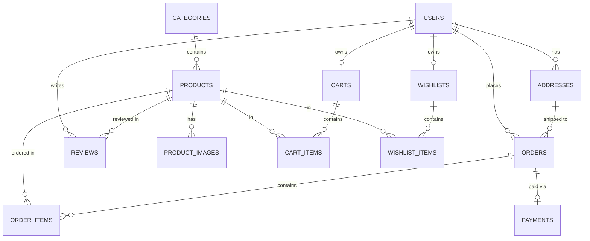
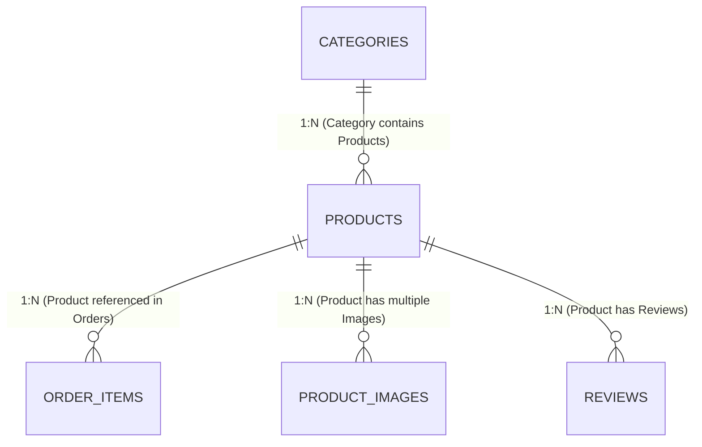
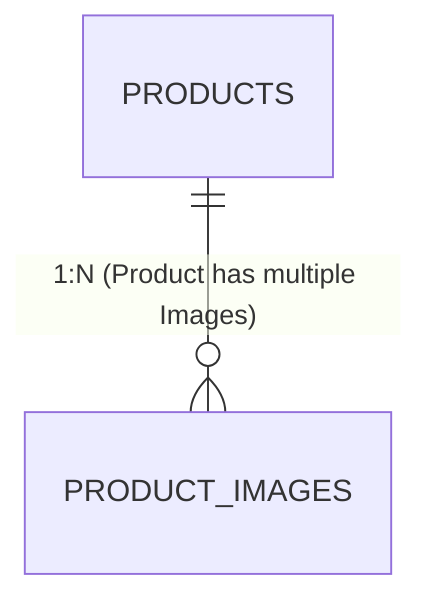
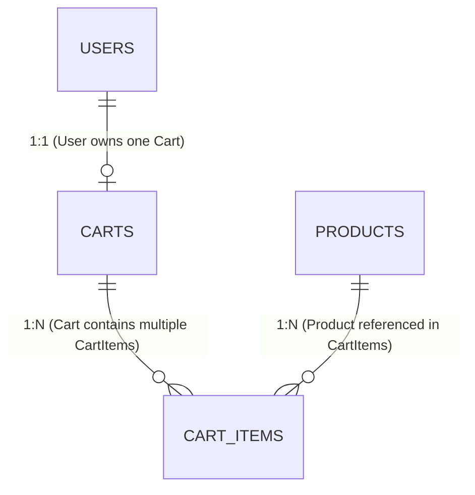
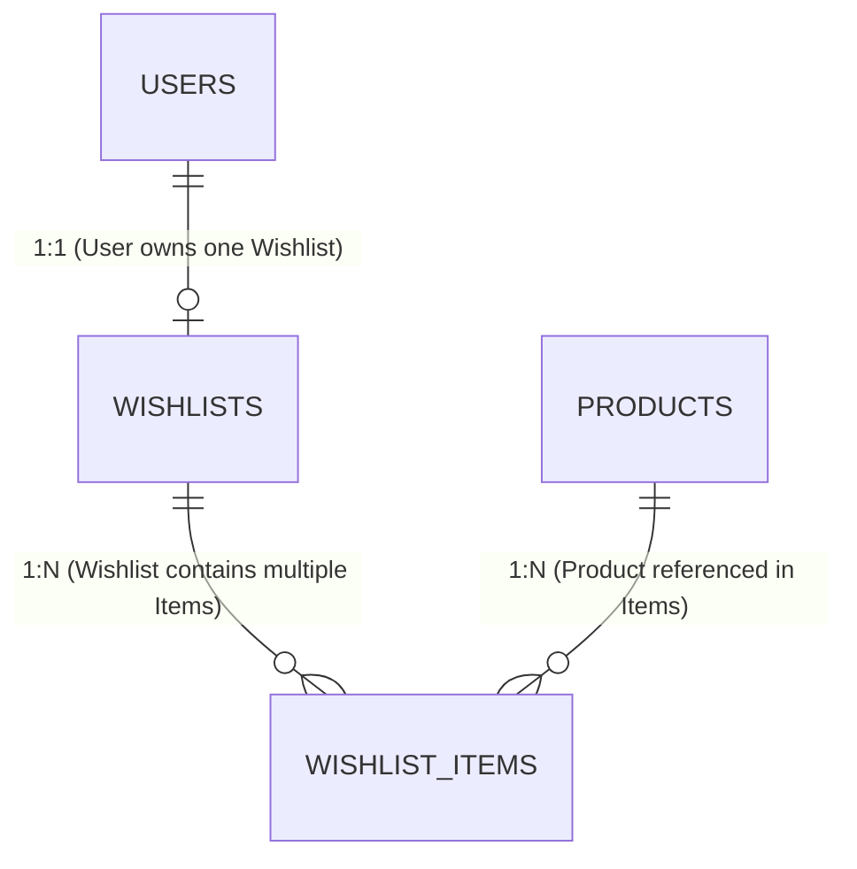

# JPBazaar Development Walkthrough

---

## Phase 1 — Database Architecture

### 1. ER Diagram & Entity Relationships



### 2. Table Schema Definitions (`sql/schema.sql`)
The PostgreSQL schema is established in [`sql/schema.sql`](file:///c:/Users/admin/Desktop/E-COMMERCE/sql/schema.sql) with 13 normalized tables and 15 secondary indexes.

---

## Phase 2 — Spring Boot Foundation

### 1. Maven Configuration (`pom.xml`)
Established Spring Boot 3.3.4 project targeting Java 21 LTS with dependencies:
- `spring-boot-starter-web`
- `spring-boot-starter-data-jpa`
- `spring-boot-starter-security`
- `spring-boot-starter-validation`
- `spring-boot-starter-data-redis`
- `postgresql` (runtime)
- `jjwt-api`, `jjwt-impl`, `jjwt-jackson` (0.12.6)
- `springdoc-openapi-starter-webmvc-ui` (2.6.0)
- `spring-boot-starter-test` & `spring-security-test`

### 2. Package Structure (`com.jpbazaar`)
```
com.jpbazaar
├── config       # OpenApiConfig, SecurityConfig, RedisConfig, JPAConfig
├── controller   # HealthCheckController, AuthController, etc.
├── service      # Business logic & transaction boundaries
├── repository   # Spring Data JPA repositories
├── entity       # JPA domain model
├── dto          # ApiResponse<T>, Request/Response records
├── mapper       # Entity <-> DTO converters
├── security     # JWT filters & SecurityContext utilities
├── exception    # Global exception handler
└── util         # AppConstants
```

### 3. Profile-Based Configuration & Secret Management
- `application.yml`: Base configuration externalized strictly to environment variable placeholders (`DB_URL`, `DB_USERNAME`, `DB_PASSWORD`, `REDIS_HOST`, `REDIS_PORT`, `JWT_SECRET`) without hardcoded secrets.
- `.env.example`: Safe local development environment template file.
- `.gitignore`: Excludes all `.env` files, build targets, and IDE settings from git commits.
- `application-dev.yml`: SQL formatting & debug logging enabled for local development.
- `application-test.yml`: H2 in-memory mode enabled for fast unit testing.

### 4. Build & Test Verification
Run via Maven:
```bash
mvn clean test
```
**Output**: `BUILD SUCCESS`, 1/1 context test passed in 9.6 seconds.

---

## Phase 3 — Entity Layer

### 1. Implemented JPA Domain Entities
Implemented 13 JPA entities in `com.jpbazaar.entity`:
1. **`User`**: `@Entity`, `@Table(name = "users")`, 1:N `Address`, 1:1 `Cart`, 1:1 `Wishlist`, 1:N `Order`, 1:N `Review`.
2. **`Address`**: `@Entity`, N:1 `User`.
3. **`Category`**: `@Entity`, 1:N `Product`.
4. **`Product`**: `@Entity`, `@Version` (`Long version` for optimistic locking in Phase 13), N:1 `Category`, 1:N `ProductImage`, 1:N `Review`.
5. **`ProductImage`**: `@Entity`, N:1 `Product`.
6. **`Cart`**: `@Entity`, 1:1 `User`, 1:N `CartItem`.
7. **`CartItem`**: `@Entity`, N:1 `Cart`, N:1 `Product`. Unique constraint on `(cart_id, product_id)`.
8. **`Wishlist`**: `@Entity`, 1:1 `User`, 1:N `WishlistItem`.
9. **`WishlistItem`**: `@Entity`, N:1 `Wishlist`, N:1 `Product`. Unique constraint on `(wishlist_id, product_id)`.
10. **`Order`**: `@Entity`, N:1 `User`, N:1 `Address`, 1:N `OrderItem`, 1:1 `Payment`.
11. **`OrderItem`**: `@Entity`, N:1 `Order`, N:1 `Product`. Historical snapshot of `productName` and `price`.
12. **`Payment`**: `@Entity`, 1:1 `Order`. Unique `transactionId`.
13. **`Review`**: `@Entity`, N:1 `User`, N:1 `Product`. Unique constraint on `(user_id, product_id)`.

### 2. Supporting Domain ENUMs
- **`Role`**: `CUSTOMER`, `ADMIN`
- **`OrderStatus`**: `PLACED`, `CONFIRMED`, `PROCESSING`, `SHIPPED`, `OUT_FOR_DELIVERY`, `DELIVERED`, `CANCELLED`
- **`PaymentMethod`**: `CARD`, `UPI`, `NET_BANKING`, `COD`
- **`PaymentStatus`**: `PENDING`, `SUCCESS`, `FAILED`, `REFUNDED`

---

## Phase 4 — Repository Layer

### 1. Implemented Spring Data JPA Repositories (`com.jpbazaar.repository`)
1. **`UserRepository`**: `findByEmail`, `existsByEmail`.
2. **`AddressRepository`**: `findByUserId`, `findByUserIdAndIsDefaultTrue`.
3. **`CategoryRepository`**: `findByName`, `existsByName`.
4. **`ProductRepository`**: `findBySku`, `existsBySku`, `findByCategoryIdAndActiveTrue`, and dynamic JPQL `searchAndFilterProducts(...)` supporting multi-parameter filtering (Category, Brand, Price Range, Active Status, Keyword) with `Pageable`.
5. **`ProductImageRepository`**: `findByProductId`.
6. **`CartRepository`**: `findByUserId`, and `findByUserIdWithItems` (`LEFT JOIN FETCH`) to solve N+1 select queries.
7. **`CartItemRepository`**: `findByCartIdAndProductId`, `deleteByCartId`.
8. **`WishlistRepository`**: `findByUserId`, `findByUserIdWithItems` (`LEFT JOIN FETCH`).
9. **`WishlistItemRepository`**: `findByWishlistIdAndProductId`, `existsByWishlistIdAndProductId`, `deleteByWishlistId`.
10. **`OrderRepository`**: `findByUserId(Pageable)`, `findByIdAndUserId` (IDOR check helper), `findByStatus(Pageable)`, and `findByIdWithItems` (`LEFT JOIN FETCH`).
11. **`OrderItemRepository`**: `findByOrderId`.
12. **`PaymentRepository`**: `findByOrderId`, `findByTransactionId`, `existsByTransactionId`.
13. **`ReviewRepository`**: `findByProductId(Pageable)`, `existsByUserIdAndProductId`, `findAverageRatingByProductId` (JPQL `SELECT COALESCE(AVG(r.rating), 0.0)`).

---

## Phase 5 — Authentication & Authorization

### 1. Security Architecture & Features
- **Stateless JWT Security**: Requests authenticated via `Authorization: Bearer <token>` header.
- **BCrypt Password Hashing**: Passwords stored as BCrypt hashes (strength 12).
- **Auto Cart/Wishlist Provisioning**: Registering a customer automatically creates their individual `Cart` and `Wishlist`.

### 2. Implemented Security Components (`com.jpbazaar.security`)
- **`JwtTokenProvider`**: Generates, signs (HMAC-SHA), parses, and validates JWT tokens with `userId` and `role` claims.
- **`SecurityUser`**: Adapts `User` entity to Spring Security `UserDetails`.
- **`CustomUserDetailsService`**: Loads user details from database by email.
- **`JwtAuthenticationFilter`**: Intercepts requests, validates token, and populates `SecurityContextHolder`.
- **`SecurityConfig`**: Configures stateless session policy, CORS, public endpoints (`/api/auth/**`, GET `/api/products/**`), and ADMIN role endpoints.
- **`AuthController`**:
  - `POST /api/auth/register`
  - `POST /api/auth/login`

---

## Phase 6 — User Module & Address Book

### 1. Implemented Features
- **User Profile Management**:
  - `GET /api/users/me`: Fetch authenticated user profile.
  - `PUT /api/users/me`: Update first name, last name, and phone.
  - `PUT /api/users/change-password`: Change password with current password verification.
- **Address Book Management (CRUD + Default)**:
  - `POST /api/addresses`: Add new shipping/billing address (auto-sets first address as default).
  - `GET /api/addresses`: List authenticated user's addresses.
  - `GET /api/addresses/{id}`: Get address by ID (IDOR protected).
  - `PUT /api/addresses/{id}`: Update address details (IDOR protected).
  - `DELETE /api/addresses/{id}`: Delete address (IDOR protected).
  - `PUT /api/addresses/{id}/set-default`: Set default address for checkout.

### 2. IDOR (Insecure Direct Object Reference) Protection Strategy
To prevent malicious customers from tampering with URL IDs (e.g., trying `GET /api/addresses/10` to view another user's address), every address operation executes an explicit ownership check:

```java
private Address getAddressAndValidateOwnership(String email, Long addressId) {
    Address address = addressRepository.findById(addressId)
            .orElseThrow(() -> new ResourceNotFoundException("Address not found with ID: " + addressId));

    if (!address.getUser().getEmail().equals(email)) {
        throw new UnauthorizedException("Access denied: You do not own address ID " + addressId);
    }
    return address;
}
```
If the authenticated user's email does not match the resource owner's email, the application throws `UnauthorizedException`, returning HTTP 403 Forbidden.

---

## Architecture & Layered Responsibilities Explanation

| Layer | Responsibility | Why Separated? |
|---|---|---|
| **Entity** | Maps Java objects directly to database tables (ORM). | Keeps DB schema details and ORM mapping decoupled from API response formats. |
| **DTO** | Data Transfer Object for API request/response payloads. | Prevents exposure of sensitive fields (e.g. `password`, internal DB IDs), avoids Jackson recursion, and stabilizes API contracts. |
| **Repository** | Data access layer (Spring Data JPA queries, JPQL). | Encapsulates database execution logic away from business services. |
| **Service** | Core business rules, transactions (`@Transactional`), and security guards. | Centralizes domain rules so they can be re-used across controllers, CLI tools, or background tasks. |
| **Controller** | HTTP endpoint handling, request parameter binding, DTO validation. | Translates web protocols (REST/JSON) to Java method calls; keeps web logic out of domain services. |

---

## Interview Preparation — Phase 6 Key Technical Questions

### Q1: What is IDOR (Insecure Direct Object Reference) and how is it mitigated in JPBazaar?
**Answer**: IDOR occurs when an application exposes a reference to an internal implementation object (like an integer ID in a URL `/api/addresses/5`), allowing an attacker to manipulate the parameter to access unauthorized data. We mitigate IDOR by enforcing contextual ownership checks in `AddressServiceImpl` and JPQL queries (`findByIdAndUserId`), ensuring the authenticated principal owns the requested resource before returning data.

### Q2: Why pass `@AuthenticationPrincipal UserDetails userDetails` to controllers instead of accepting `Long userId` as a `@PathVariable` or `@RequestParam`?
**Answer**: Accepting `userId` in parameters allows malicious users to send someone else's ID. Relying on `@AuthenticationPrincipal` retrieves the user's identity directly from the cryptographically verified JWT token inside `SecurityContextHolder`, eliminating parameter tampering attacks.

### Q3: How do you handle setting a new Default Address when another address is already marked as default?
**Answer**: In `AddressServiceImpl`, when `isDefault = true` is passed, the service queries `findByUserIdAndIsDefaultTrue(userId)` within an `@Transactional` block, unsets the previous default address (`isDefault = false`), and marks the target address as default.

---

## Phase 7 — Product and Category Module

### 1. Overview & Architecture
Phase 7 implements full management and discovery of catalog items:
- Hierarchical **Categories** (`Category`) with uniqueness rules and deletion safety constraints.
- Multi-dimensional **Products** (`Product`) with optimistic locking support (`@Version`), SKU uniqueness, rich attribute management, dynamic multi-parameter search/filtering, and historical order protection.
- Standardized, pagination-aware API responses using a decoupled `PageResponse<T>` DTO.

### 2. Key Components & Implementation Details

#### DTOs (`com.jpbazaar.dto`)
- **`CategoryRequest`**: Validates category name (`@NotBlank`, max 100) and optional description.
- **`CategoryResponse`**: Clean read model exposing category ID, name, description, and audit timestamp.
- **`ProductCreateRequest`**: Strict validation for adding products (`name`, `description`, positive `price`, non-negative `stockQuantity`, `sku`, `brand`, `categoryId`).
- **`ProductUpdateRequest`**: Partial/full modification of product attributes with stock validation.
- **`ProductResponse`**: Rich catalog item model including category reference (`categoryName`, `categoryId`), active flag, and stock level.
- **`PageResponse<T>`**: Generic paginated metadata wrapper (`content`, `pageNumber`, `pageSize`, `totalElements`, `totalPages`, `isLast`) ensuring decoupling from internal Spring Data classes.

#### Repository Extensions (`com.jpbazaar.repository`)
- **`CategoryRepository`**:
  - `existsByNameAndIdNot(String name, Long id)`: Enforces unique category names across updates.
- **`ProductRepository`**:
  - `existsByCategoryId(Long categoryId)`: FK constraint safety check preventing deletion of categories that have active products.
  - `existsBySkuAndIdNot(String sku, Long id)`: Enforces unique SKU codes during product updates.
  - `searchAndFilterProducts(...)`: Single dynamic JPQL query with optional filters for `categoryId`, `brand`, `minPrice`, `maxPrice`, `active`, and case-insensitive keyword search matching name or description, seamlessly integrated with `Pageable`.
- **`OrderItemRepository`**:
  - `existsByProductId(Long productId)`: Blocks hard deletion of products that have already been ordered by customers.

#### Services (`com.jpbazaar.service`)
- **`CategoryServiceImpl`**:
  - Prevents duplicate category names (`DuplicateResourceException`).
  - Guards category deletion: Rejects deletion if any products belong to the category (`InvalidRequestException`), preserving database integrity.
- **`ProductServiceImpl`**:
  - Enforces SKU uniqueness across creation and updates.
  - Validates category existence before linking.
  - Guards product deletion: Blocks deletion if the product exists in historical orders (`orderItemRepository.existsByProductId`). For products with purchase history, soft deactivation (`active = false`) is required instead of hard deletion.
  - Dynamic product search & pagination with Spring Data `Pageable` and sort orders.

#### Controllers & Endpoints
- **`CategoryController`** (`/api/categories`):
  - `POST /api/categories`: Admin only (HTTP 201 Created)
  - `GET /api/categories`: Public access (HTTP 200 OK)
  - `GET /api/categories/{id}`: Public access (HTTP 200 OK)
  - `PUT /api/categories/{id}`: Admin only (HTTP 200 OK)
  - `DELETE /api/categories/{id}`: Admin only (HTTP 200 OK)
- **`ProductController`** (`/api/products`):
  - `GET /api/products`: Public catalog search, filter, and pagination (HTTP 200 OK)
    - Query parameters: `categoryId`, `brand`, `minPrice`, `maxPrice`, `active`, `keyword`, `page`, `size`, `sortBy`, `sortDir`
  - `GET /api/products/{id}`: Public product details (HTTP 200 OK)
  - `POST /api/products`: Admin only (HTTP 201 Created)
  - `PUT /api/products/{id}`: Admin only (HTTP 200 OK)
  - `DELETE /api/products/{id}`: Admin only (HTTP 200 OK)

---

### 3. Database Relationships



1. **Category to Product (1:N)**: One category groups multiple products. A product belongs to exactly one category (`@ManyToOne(fetch = FetchType.LAZY)`).
2. **Product to OrderItem (1:N)**: An ordered item references a product. Even if product details change later, the order item captures the historical price and name at purchase time.
3. **Product to ProductImage (1:N)**: Products can feature multiple images with a designated primary thumbnail.

---

### 4. Interview Preparation — Phase 7 Key Technical Questions

#### Q1: Why should an e-commerce platform avoid hard-deleting products that have prior purchase history?
**Answer**: Hard-deleting a product that exists in `order_items` causes a foreign key constraint violation (`DataIntegrityViolationException`) or cascades to delete customer order history, destroying tax, accounting, and dispute records. In JPBazaar, we verify `orderItemRepository.existsByProductId(id)` before deletion. If orders exist, hard deletion is rejected and admins must deactivate the item (`active = false`) instead.

#### Q2: How does JPBazaar implement multi-criteria filtering without creating dozens of repository finder methods?
**Answer**: We use dynamic JPQL with coalesced/null-safe parameters:
```sql
WHERE (:categoryId IS NULL OR p.category.id = :categoryId)
  AND (:brand IS NULL OR LOWER(p.brand) = LOWER(:brand))
  AND (:minPrice IS NULL OR p.price >= :minPrice)
  AND (:maxPrice IS NULL OR p.price <= :maxPrice)
  AND (:active IS NULL OR p.active = :active)
  AND (:keyword IS NULL OR LOWER(p.name) LIKE LOWER(CONCAT('%', :keyword, '%'))
       OR LOWER(p.description) LIKE LOWER(CONCAT('%', :keyword, '%')))
```
Spring Data JPA evaluates these conditions conditionally and pairs with `Pageable` to automatically append `LIMIT`, `OFFSET`, and dynamic `ORDER BY` clauses.

#### Q3: Why return a custom `PageResponse<T>` record instead of Spring's `org.springframework.data.domain.Page<T>`?
**Answer**: Returning `Page<T>` directly exposes framework-specific internal structures (such as `pageable.sort.sorted`, `numberOfElements`, `empty`) which complicates frontend consumption, violates the separation between domain persistence abstractions and API contracts, and causes Jackson serialization bloat. `PageResponse<T>` delivers a clean, consistent contract: `content`, `pageNumber`, `pageSize`, `totalElements`, `totalPages`, and `isLast`.

#### Q4: Why is category deletion protected against non-empty categories?
**Answer**: Deleting a category with associated products would leave products orphaned (or cause FK constraint failure). In `CategoryServiceImpl.deleteCategory()`, we run `productRepository.existsByCategoryId(id)` first. If true, the operation immediately aborts with an informative `InvalidRequestException`.

---

## Phase 8 — Product Images

### 1. Overview & Architecture
Phase 8 implements product image management using an extensible, pluggable **Strategy Pattern** for storage:
- **Zero Database Bloat**: Large binary images are stored outside PostgreSQL (on local disk with future drop-in support for Cloudinary or AWS S3). The database stores lightweight image metadata (URL, primary flag, product link).
- **Extensible Storage Abstraction**: `ImageStorageService` interface decouples the product module from the underlying file repository.
- **Multipart Upload & Static Streaming**: Supports multipart binary file uploads (`image/png`, `image/jpeg`, `image/webp`, `image/gif`) and public image streaming with HTTP caching headers.
- **Primary Image Lifecycle**: Guarantees exactly one primary thumbnail per product, auto-assigns the initial upload as primary, and elevates remaining images if the primary image is removed.

### 2. Key Components & Implementation Details

#### Storage Abstraction (`com.jpbazaar.service.storage`)
- **`ImageStorageService`**: Interface declaring `upload(file, folder)`, `delete(imageUrl)`, `loadAsResource(filename)`, and `getContentType(filename)`.
- **`LocalStorageServiceImpl`**:
  - Configurable storage root via `app.upload.dir` (defaults to `uploads/images`, configured to `target/test-uploads` during tests).
  - Validates MIME types (`ALLOWED_CONTENT_TYPES`).
  - Path traversal defense: validates paths, rejects `..` sequences, and normalizes file paths.
  - Generates collision-proof UUID filenames.
  - Gracefully ignores remote CDN URLs (`http://`, `https://`) during local disk deletions.

#### DTOs (`com.jpbazaar.dto`)
- **`ProductImageRequest`**: Validates image URL (`@NotBlank`, max 512) and `isPrimary` flag.
- **`ProductImageResponse`**: Returns `id`, `productId`, `imageUrl`, and `isPrimary`.

#### Repositories (`com.jpbazaar.repository`)
- **`ProductImageRepository`**:
  - `findByIdAndProductId(Long id, Long productId)`: Ensures images belong to the specified product.
  - `findByProductIdAndIsPrimaryTrue(Long productId)`: Retrieves current primary thumbnail.
  - `findByProductIdOrderByIsPrimaryDescIdAsc(Long productId)`: Returns catalog images with the primary image first.

#### Services (`com.jpbazaar.service`)
- **`ProductImageServiceImpl`**:
  - `addImage`: Adds image by URL, auto-sets primary if it's the first image.
  - `uploadImage`: Uploads multipart file via `ImageStorageService`, binds to product.
  - `getProductImages`: Returns all images for product (public).
  - `setPrimaryImage`: Unsets existing primary and sets specified image as primary.
  - `deleteProductImage`: Deletes physical file from disk (if local), removes entity, and auto-elevates first remaining image to primary.

#### Controllers & Endpoints
- **`ProductImageController`** (`/api/products/{productId}/images`):
  - `POST /api/products/{productId}/images`: Admin only (HTTP 201)
  - `POST /api/products/{productId}/images/upload`: Admin only multipart upload (HTTP 201)
  - `GET /api/products/{productId}/images`: Public access (HTTP 200)
  - `PUT /api/products/{productId}/images/{imageId}/primary`: Admin only (HTTP 200)
  - `DELETE /api/products/{productId}/images/{imageId}`: Admin only (HTTP 200)
- **`ImageController`** (`/api/images/{*filePath}`):
  - `GET /api/images/{*filePath}`: Public image streaming with `Cache-Control: public, max-age=86400` and `inline` Content-Disposition.

---

### 3. Database Relationships



- **Product to ProductImage (1:N)**: A product can feature multiple images. One image is designated as `is_primary = true` to serve as the catalog thumbnail. When a product is deleted, all associated `ProductImage` records are deleted via `CascadeType.ALL, orphanRemoval = true`.

---

### 4. Interview Preparation — Phase 8 Key Technical Questions

#### Q1: Why should an e-commerce platform avoid storing image binary data (BLOBs) directly in PostgreSQL?
**Answer**: Storing multi-megabyte binary data in relational tables leads to table bloat, degrades buffer cache hit ratios, exhausts database I/O bandwidth, drastically inflates backup/restore times, and bypasses edge CDN caching. Storing file metadata (URLs) in the database and the actual binary objects on disk or object stores (S3, Cloudinary) separates concerns and allows CDN edge-caching.

#### Q2: How does JPBazaar support switching from local storage to AWS S3 or Cloudinary without rewriting the Product module?
**Answer**: We use the Strategy Pattern via `ImageStorageService`. The controller and product services depend solely on `ImageStorageService`. To switch to AWS S3 or Cloudinary, developers provide an implementation (e.g. `S3ImageStorageService`) annotated with `@ConditionalOnProperty(name = "app.storage.type", havingValue = "s3")`. No modifications to `ProductService` or `ProductImageController` are needed.

#### Q3: How do you prevent Path Traversal attacks during file uploads and downloads?
**Answer**: In `LocalStorageServiceImpl`, file names are sanitized using `StringUtils.cleanPath()`, inspected for `..` relative path segments, and validated against the root storage directory using `destinationPath.normalize().startsWith(rootLocation)`. Furthermore, uploaded files are assigned randomly generated UUIDs, preventing attackers from overwriting system files.

#### Q4: How is primary image consistency maintained when deleting images?
**Answer**: In `ProductImageServiceImpl.deleteProductImage()`, if the deleted image was marked as `isPrimary = true`, the service queries remaining images for that product. If images remain, the first remaining image is automatically elevated to `isPrimary = true`, preventing products from being left without a thumbnail.

---

## Phase 9 — Cart Module

### 1. Overview & Architecture
Phase 9 delivers a shopping cart module for **JPBazaar**:
- **Automatic Lifecycle Provisioning**: Every registered user has a dedicated cart; if missing upon request, it is provisioned on demand.
- **Duplicate Prevention with Quantity Merging**: Adding a product that already exists in the cart merges quantities rather than creating duplicate line items, maintaining the `(cart_id, product_id)` database uniqueness constraint.
- **Strict Business & Stock Validation**: Rejects inactive products and validates requested quantities against real-time stock levels, throwing `InsufficientStockException` if stock is exceeded.
- **IDOR Protection**: Ensures customers can only view, mutate, or delete line items from their own cart.
- **Real-Time Financial Calculations**: Automatically calculates line-item subtotals, cart item count, and total cart amount.

### 2. Key Components & Implementation Details

#### DTOs (`com.jpbazaar.dto`)
- **`AddToCartRequest`**: Validates `productId` (`@NotNull`) and `quantity` (`@Min(1)`).
- **`UpdateCartItemRequest`**: Validates `quantity` (`@NotNull`, `@Min(1)`).
- **`CartItemResponse`**: Details for each cart item (`id`, `productId`, `productName`, `productSku`, `unitPrice`, `quantity`, `subtotal`, `imageUrl`).
- **`CartResponse`**: Cart aggregate view (`id`, `userId`, `items`, `totalItemCount`, `totalAmount`).

#### Exceptions & Error Handling (`com.jpbazaar.exception`)
- **`InsufficientStockException`**: Dedicated exception thrown when a user requests more units than available in stock. Handled by `GlobalExceptionHandler` returning HTTP 400 Bad Request with an informative error message.

#### Repository Extensions (`com.jpbazaar.repository`)
- **`CartRepository`**:
  - `findByUserEmail(String email)`
  - `findByUserEmailWithItems(String email)`: Executes `LEFT JOIN FETCH c.items i LEFT JOIN FETCH i.product p LEFT JOIN FETCH p.category` to solve the N+1 SELECT query problem in a single database round-trip.
- **`CartItemRepository`**:
  - `findByIdAndCartId(Long id, Long cartId)`: Validates ownership to protect against IDOR attacks.
  - `deleteByCartId(Long cartId)`: Enables clearing the entire cart.

#### Services (`com.jpbazaar.service`)
- **`CartServiceImpl`**:
  - `getCart`: Fetches the authenticated user's cart with eager fetch joins.
  - `addToCart`:
    - Validates product existence and active status.
    - Checks for existing product in cart: if found, validates `existingQuantity + newQuantity <= stock` and updates quantity; otherwise creates new `CartItem`.
  - `updateCartItemQuantity`: Validates that the cart item belongs to the caller's cart (IDOR guard) and that the new quantity is within product stock.
  - `removeCartItem`: Verifies cart ownership and deletes the cart item.
  - `clearCart`: Deletes all cart items for the user's cart.
  - `mapToCartResponse`: Calculates subtotals ($unitPrice \times quantity$), total item count ($\sum quantity$), and total amount ($\sum subtotal$), while associating the product's primary thumbnail image.

#### Controllers & Endpoints
- **`CartController`** (`/api/cart`):
  - `GET /api/cart`: Current authenticated user's cart (HTTP 200 OK)
  - `POST /api/cart/items`: Add product to cart (HTTP 201 Created)
  - `PUT /api/cart/items/{itemId}`: Update item quantity (HTTP 200 OK)
  - `DELETE /api/cart/items/{itemId}`: Remove item from cart (HTTP 200 OK)
  - `DELETE /api/cart`: Clear cart (HTTP 200 OK)

---

### 3. Database Relationships



- **User to Cart (1:1)**: Every user owns exactly one cart (`uk_carts_user` unique constraint on `user_id`).
- **Cart to CartItem (1:N)**: A cart holds multiple items. Unique constraint on `(cart_id, product_id)` ensures a product appears at most once in a given cart. When a cart is cleared or deleted, `orphanRemoval = true` ensures associated items are cleanly cascade-deleted.

---

### 4. Interview Preparation — Phase 9 Key Technical Questions

#### Q1: How does JPBazaar prevent duplicate line items when a user adds the same product to their cart twice?
**Answer**: In `CartServiceImpl.addToCart()`, the service inspects the cart's existing items for matching `productId`. If already present, it verifies that the combined quantity (`currentQuantity + requestedQuantity`) does not exceed stock, and updates the existing `CartItem`'s quantity in place instead of creating a second entity. This respects the database `(cart_id, product_id)` unique constraint and prevents database constraint violation errors.

#### Q2: How does JPBazaar avoid the N+1 query problem when loading a user's shopping cart?
**Answer**: Without eager fetching, loading a cart containing 10 items would execute 1 query for the cart, 1 query for the items, and 10 separate queries for each associated product ($1 + 1 + N$). In `CartRepository`, we define `findByUserEmailWithItems`:
```sql
SELECT c FROM Cart c 
LEFT JOIN FETCH c.items i 
LEFT JOIN FETCH i.product p 
LEFT JOIN FETCH p.category 
WHERE c.user.email = :email
```
This loads the entire cart, its items, and product details in a single SQL query.

#### Q3: How is IDOR mitigated when a user updates or deletes a cart item?
**Answer**: An attacker might guess or enumerate `cartItemId` (e.g. `PUT /api/cart/items/45`) to modify someone else's cart. In `CartServiceImpl`, every mutation executes `cartItemRepository.findByIdAndCartId(cartItemId, cart.getId())`. If the item ID does not belong to the authenticated user's cart ID, the query returns empty and the service throws `UnauthorizedException` (HTTP 403 Forbidden).

---

## Phase 10 — Wishlist Module

### 1. Overview & Architecture
Phase 10 implements the Wishlist module for **JPBazaar**:
- **Personalized Product Bookmarking**: Allows registered users to bookmark products they want to save or buy later.
- **Duplicate Prevention**: Enforces a strict uniqueness invariant per user wishlist. If a product is already on the user's wishlist, attempting to re-add it results in an HTTP 409 Conflict via `DuplicateResourceException`.
- **Eager Fetch Join Optimization**: Eliminates the N+1 query problem by using JPQL `LEFT JOIN FETCH` across wishlist items, product entities, and categories in a single query.
- **IDOR Protection**: Verifies ownership before removing wishlist items (`findByIdAndWishlistId`), ensuring users cannot manipulate other users' wishlists.
- **Dual Removal Options**: Supports removing items by wishlist item ID (`DELETE /api/wishlist/items/{itemId}`) or directly by product ID (`DELETE /api/wishlist/products/{productId}`), facilitating seamless toggle UI integration on product cards.
- **Stock and Image Enrichment**: Projects live stock availability (`inStock`) and primary thumbnail image URLs on each wishlist item response.

### 2. Key Components & Implementation Details

#### DTOs (`com.jpbazaar.dto`)
- **`AddToWishlistRequest`**: Contains `@NotNull Long productId` to identify which product to add.
- **`WishlistItemResponse`**: Structured response for individual wishlisted items:
  - `id`: Unique identifier of the wishlist item.
  - `productId`: ID of the wishlisted product.
  - `productName`: Name of the product.
  - `productSku`: Unique SKU code.
  - `price`: Unit price at current retrieval.
  - `inStock`: Boolean indicating whether `stockQuantity > 0`.
  - `imageUrl`: URL of the product's primary thumbnail image.
  - `addedAt`: Timestamp when the item was added to the wishlist.
- **`WishlistResponse`**: Overall wishlist aggregate:
  - `id`: Wishlist ID.
  - `userId`: User ID of the owner.
  - `items`: List of `WishlistItemResponse`.
  - `totalItems`: Total count of wishlisted items.

#### Repository Extensions (`com.jpbazaar.repository`)
- **`WishlistRepository`**:
  - `findByUserEmail(String email)`: Simple lookup by user email.
  - `findByUserEmailWithItems(String email)`: Performs `LEFT JOIN FETCH w.items i LEFT JOIN FETCH i.product p LEFT JOIN FETCH p.category WHERE w.user.email = :email` to eliminate N+1 queries.
- **`WishlistItemRepository`**:
  - `findByIdAndWishlistId(Long id, Long wishlistId)`: IDOR-safe retrieval.
  - `existsByWishlistIdAndProductId(Long wishlistId, Long productId)`: Quick duplicate existence check.
  - `deleteByWishlistIdAndProductId(Long wishlistId, Long productId)`: Direct product removal from wishlist.
  - `deleteByWishlistId(Long wishlistId)`: Clear all items in wishlist.

#### Services (`com.jpbazaar.service`)
- **`WishlistServiceImpl`**:
  - `getWishlist(userEmail)`: Fetches user's wishlist or creates one if not present, then maps to `WishlistResponse`.
  - `addToWishlist(userEmail, request)`:
    1. Validates product existence and active status.
    2. Checks for duplicates via `existsByWishlistIdAndProductId`. If present, throws `DuplicateResourceException`.
    3. Persists new `WishlistItem` and returns updated `WishlistResponse`.
  - `removeWishlistItem(userEmail, itemId)`:
    1. Validates item existence and verifies ownership via `findByIdAndWishlistId`.
    2. If not found or mismatch, throws `UnauthorizedException` (IDOR defense).
    3. Deletes item and returns updated wishlist.
  - `removeProductFromWishlist(userEmail, productId)`:
    1. Deletes by `wishlistId` and `productId`.
    2. Returns updated wishlist.
  - `clearWishlist(userEmail)`:
    1. Deletes all items for the user's wishlist.
    2. Returns empty `WishlistResponse`.

#### Controllers & Endpoints
- **`WishlistController`** (`/api/wishlist`):
  - `GET /api/wishlist`: Retrieve current user's wishlist (HTTP 200 OK)
  - `POST /api/wishlist/items`: Add product to wishlist (HTTP 201 Created)
  - `DELETE /api/wishlist/items/{itemId}`: Remove item from wishlist (HTTP 200 OK)
  - `DELETE /api/wishlist/products/{productId}`: Remove product by product ID (HTTP 200 OK)
  - `DELETE /api/wishlist`: Clear all wishlist items (HTTP 200 OK)

---

### 3. Database Relationships



- **User to Wishlist (1:1)**: Each user has exactly one wishlist record (`uk_wishlists_user` unique constraint on `user_id`).
- **Wishlist to WishlistItem (1:N)**: A wishlist contains zero or more items. Unique constraint on `(wishlist_id, product_id)` ensures a product cannot be bookmarked twice.
- **Product to WishlistItem (1:N)**: Each item references a product. Cascades handle cleanup on wishlist deletion.

---

### 4. Interview Preparation — Phase 10 Key Technical Questions

#### Q1: What is the architectural difference between a Shopping Cart item and a Wishlist item?
**Answer**:
- **Cart Item**: Represents purchase intent with variable quantity. When a user adds an existing item, the system merges quantities (`existingQuantity + newQuantity`) up to stock limits.
- **Wishlist Item**: Represents a set bookmark (binary inclusion). There is no quantity concept. Adding an existing product is an idempotency or conflict scenario. In JPBazaar, we enforce set semantics at both the DB level (`uk_wishlist_items_wishlist_product`) and application level, returning HTTP 409 Conflict with `DuplicateResourceException`.

#### Q2: Why provide two different DELETE endpoints (`/items/{itemId}` and `/products/{productId}`)?
**Answer**:
- On the **Wishlist Page**, the UI iterates through wishlist line items and has direct access to the `itemId`. Calling `DELETE /api/wishlist/items/{itemId}` directly targets that item with IDOR protection.
- On the **Product Catalog / Product Detail Page**, the UI is rendering products and only has `productId`. To provide a wishlist toggle button (heart icon) without requiring the UI to first query or search for the corresponding `wishlistItemId`, `DELETE /api/wishlist/products/{productId}` enables direct removal by product ID.

#### Q3: How does JPBazaar prevent Insecure Direct Object Reference (IDOR) attacks on wishlist deletions?
**Answer**:
If an attacker sends `DELETE /api/wishlist/items/99` trying to delete another user's item, the service does not execute `deleteById(99)`. Instead:
1. It resolves the authenticated user from the Spring Security context (`userEmail`).
2. It fetches the user's own `Wishlist` entity.
3. It queries `wishlistItemRepository.findByIdAndWishlistId(itemId, wishlist.getId())`.
If the item belongs to another user's wishlist, the query returns empty and the service throws `UnauthorizedException` (HTTP 403 Forbidden).
